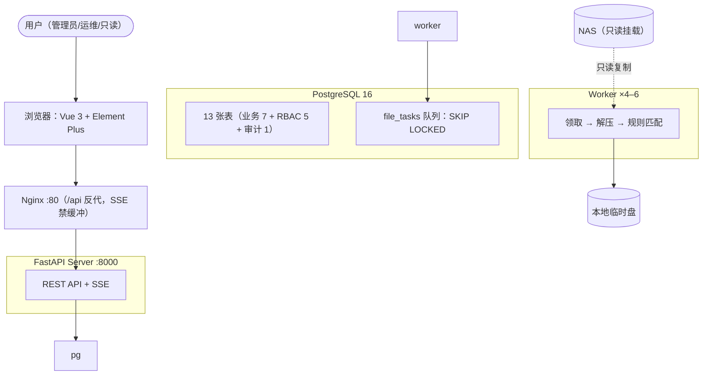

<div align="center">

# LogHarvest

**压缩日志规则提取平台 · Compressed Log Rule Extraction Platform**

[](LICENSE)


</div>

LogHarvest 面向企业 NAS 上的海量压缩日志：管理员在 Web 上配置数据源与规则集、指定要分析的目录，Server 递归扫描把每个压缩包拆成文件任务，多 Worker 并发**复制 → 流式解压 → 逐行规则匹配 → 结果入库（PostgreSQL）**，最后在 Web 上查实时进度、重试历史、失败原因与命中结果。

设计目标规模：单批 **500 GB** / **1000+ 压缩包** / 单文件**十万行级**。

## ✨ 功能特性

- **任务流水线**：数据源（只读守卫）→ 规则集（版本化 + 编译期校验）→ 作业创建（同步扫描规划、幂等键）→ 文件任务队列（PostgreSQL `SKIP LOCKED`）
- **Worker 引擎**：多进程领取循环、租约栅栏（`id + attempts + status`）、心跳续租、线性退避、僵死回收、成员级 `partial` 容错、压缩炸弹四维解压预算
- **实时可观测**：SSE 作业进度（断流自动降级轮询）、尝试历史抽屉、任务统计（UTC 日界聚合 + Top 规则）、Worker 资源上报（CPU/内存/临时盘）
- **命中分析**：`(created_at, id)` 游标分页、按规则/文件/严重度过滤、关键字与正则命名分组阈值规则、跨版本规则索引
- **安全与权限**：JWT 双令牌 + bcrypt（超 72 字节先摘要）、登录限流（滑动窗口）、菜单即权限的 RBAC（3 角色 / 19 权限码 / 动态路由）、24 类写操作审计留痕
- **工程化**：后端 686 条测试（无 PG 环境自动跳过 20 条集成用例；已跟踪模块覆盖率 97%）+ 前端 102 条 vitest、ruff/mypy/vue-tsc 门禁、Docker Compose 编排、Jenkins 含真实 PG 集成门禁的 drain 滚动发布

## 🏗 架构总览



更完整的架构说明见 [docs/architecture.md](docs/architecture.md)（含端到端数据流与设计决策），4+1 视图见 [docs/architecture-4plus1.md](docs/architecture-4plus1.md)。

## 🚀 快速开始

### Docker Compose（生产形态，推荐）

三个独立部署栈（数据库 / 控制面 / Worker），所有数据归档在数据盘 `/usr1/logharvest/`：

```bash
git clone git@github.com:taoweidong/logharvest.git && cd logharvest
sudo bash deploy/init-dirs.sh                       # /usr1 目录规划 + 跨栈网络（幂等）
cp deploy/postgres/.env.example deploy/postgres/.env && vi deploy/postgres/.env   # PG 口令
docker compose -f deploy/postgres/docker-compose.yml --env-file deploy/postgres/.env up -d --wait

cp deploy/server/.env.example deploy/server/.env && vi deploy/server/.env         # JWT 密钥/管理员口令
docker compose -f deploy/server/docker-compose.yml --env-file deploy/server/.env up -d --wait

cp deploy/worker/.env.example deploy/worker/.env && vi deploy/worker/.env         # NAS 目录
docker compose -f deploy/worker/docker-compose.yml --env-file deploy/worker/.env up -d --scale worker=4
# 打开 http://localhost/ ，用管理员账号登录
```

栈拆分、目录规划与运维见 [docs/deployment-docker.md](docs/deployment-docker.md)；CI/CD 见 [docs/deployment-jenkins.md](docs/deployment-jenkins.md)。

### 本地开发（SQLite 快速路径）

```bash
# 后端
cd service && uv sync --python 3.12
cp ../.env.example .env        # 填写 LOGHARVEST_JWT_SECRET_KEY（必填）
LOGHARVEST_ADMIN_PASSWORD='devpass123' uv run --python 3.12 -m scripts.seed_admin
uv run --python 3.12 uvicorn src.main:app --reload --port 8000

# 前端（另开终端）
cd web && corepack enable && pnpm install && pnpm dev   # http://localhost:8848
```

完整指导（含 PostgreSQL + Worker 全链路与联调边界）见 [docs/local-development.md](docs/local-development.md)。

## 📚 文档导航

| 文档 | 内容 |
|---|---|
| [整体设计架构](docs/architecture.md) | 系统定位、硬约束、三服务架构、技术选型、数据流、设计决策 |
| [4+1 架构视图](docs/architecture-4plus1.md) | 场景 / 逻辑 / 开发 / 过程 / 物理五个视图（全 Mermaid） |
| [核心逻辑说明](docs/core-logic.md) | 作业规划、队列租约、Worker 容错、解压预算、规则引擎、终态汇总、SSE、RBAC 与审计 |
| [本地开发指导](docs/local-development.md) | 环境搭建、启动、联调、测试门禁、调试入口、FAQ |
| [Docker 部署说明](docs/deployment-docker.md) | 镜像与编排、首次部署、运维、升级回滚、安全清单 |
| [Jenkins 自动化说明](docs/deployment-jenkins.md) | 流水线阶段、凭据、drain 滚动升级语义、回滚 |
| [后端 README](service/README.md) | API 契约全表、配置项、迁移、认证细节、验证边界 |
| [前端 README](web/README.md) | 界面清单、联调、SSE 设计、上游声明 |
| [协作规范](agent.md) | AI/人工提交的强制测试门禁 |

## 🧪 开发与测试

```bash
# 后端：686 条用例（无 PG 环境 666 通过，20 条集成用例自动跳过）；ruff + mypy 静态门禁
cd service
uv run --python 3.12 pytest -q
uv run --python 3.12 ruff check src tests && uv run --python 3.12 mypy

# 前端：102 条 vitest 用例 + 类型检查
cd web
pnpm test && pnpm typecheck
```

> **协作门禁**（`agent.md`）：每一次 AI 交互与代码提交前，必须前后端测试全部通过；测试未通过不得提交，先定位修复再重新验证。

## 📌 路线图

已交付：M0 核心引擎、M1a 控制面 API、M1b Worker/队列、M2a 认证/运维、M2b 前端、M2c 安全/可观测、RBAC 菜单权限与操作日志、Docker/Jenkins 编排。

后续演进（按主设计与评估文档排期）：

- M3 多行堆栈规则（设计已评审）
- `matches` 按月分区与结果保留期
- Worker 内存压力自适应降并发；Prometheus 指标接入
- 数据权限（部门/本人范围）、token 吊销 / 服务端会话

## 🤝 贡献

1. Fork → 分支 → 改动 → 自测（前后端测试全绿，见上）。
2. 提交信息使用约定式前缀（`feat:` / `fix:` / `refactor:` / `test:` / `docs:` / `chore:`），单一意图。
3. 涉及数据库变更必须走 Alembic 迁移并保持向后兼容（先加后删）。
4. 新增/修改接口时同步维护后端 schema、前端 TS 类型与双方测试。
5. 欢迎 issue 与 PR；重大改动请先开 issue 对齐。

## 📄 许可证

[MIT](LICENSE) © Taowd

前端派生自 [vue-pure-admin](https://github.com/pure-admin/vue-pure-admin)（MIT），上游许可原文保留于 [web/LICENSE](web/LICENSE)；框架层归上游，业务页面为本项目自有代码。

## 🙏 致谢

- [vue-pure-admin](https://github.com/pure-admin/vue-pure-admin) — 中后台基座
- [FastAPI](https://github.com/tiangolo/fastapi) · [SQLModel](https://github.com/tiangolo/sqlmodel) · [Element Plus](https://github.com/element-plus/element-plus) · [Alembic](https://github.com/sqlalchemy/alembic)
