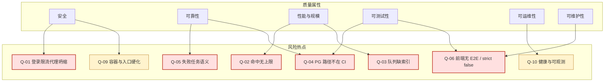

# LogHarvest 代码质量报告（2026-10-28）

> 独立复核报告。基线：`main` @ `102a153`（工作区另有未跟踪的 `service/scripts/e2e_bench.py` 与 `.gitignore` 本地修改，未计入质量基线）。
> 同目录已有 `2026-10-28-quality-assessment-report-and-optimization-plan.md`（逐文件审计 + 分阶段优化）。本报告是第二轮独立全量复核，重点补充**可量化证据、真实 PostgreSQL 验证、生产门禁缺口**；与既有报告重叠的发现标注「继承复核」，并逐条确认当前代码仍然成立。

---

## 一、结论摘要

**总体判断：工程质量明显高于同类业务系统。** 分层方向、队列租约、解压预算、认证时序防护、前端契约注释都体现了较强的工程纪律；后端 500 条单测、97% 覆盖率、前端 77 条纯逻辑用例、40 个前端 API 调用逐条命中后端 47 个端点中的对应路径（0 不匹配），都是可验证的事实。

**没有发现新的 P0 代码缺陷。** 专项排查并排除：SQL 注入（全部参数化 + LIKE 转义）、`v-html`、硬编码密钥、默认口令、未鉴权业务端点、路径穿越、压缩包符号链接逃逸。

**真正的风险不在「代码写得对不对」，而在「生产路径是否被验证」与「规模化边界是否被守住」：**

| 排名 | 风险 | 级别 | 一句话 |
|---|---|---|---|
| 1 | 登录限流在 nginx 后失去来源区分 | P1 | 任意来源对 `admin` 失败 10 次，可让所有经 nginx 的新登录被锁 5 分钟 |
| 2 | `max_matches_per_task` 配置零引用 | P1 | 一条空关键字/`.*` 规则可把 `matches` 表写到磁盘耗尽 |
| 3 | 队列领取查询缺索引 | P1 | 34 万任务实测 140.7ms/次；加部分索引后 0.26ms |
| 4 | PostgreSQL 路径不在 CI 门禁 | P1 | 18 个 PG 集成用例默认跳过；迁移链只在生产启动时跑 |
| 5 | 失败任务半截命中可见 + 瞬时 NAS 错误判永久失败 | P1 | 结果一致性受损；NAS 抖动会把整批任务变成「假失败」 |

**如果只能先做三件事：**
1. 执行 `max_matches_per_task`，并给 `file_tasks` 补领取/回收索引（各加一条迁移 + 回归测试）。
2. 修正反向代理下的客户端 IP 识别（或明确不暴露 API 端口），让限流按真实来源分桶。
3. 把 PostgreSQL 集成套件和「空库 `alembic upgrade head`」放进 Jenkins。

### 质量属性速览

| 属性 | 结论 | 主要依据 |
|---|---|---|
| 功能正确性 | 强 | 500 条后端用例；租约栅栏/补偿收尾/解压预算均有测试；真实 PG 18 条集成用例通过 |
| 安全 | 良好，生产硬化待补 | 认证/授权/审计设计扎实；限流代理坍缩、依赖 CVE、容器 root、无 TLS/安全头 |
| 可靠性 | 良好，失败语义有缺口 | 心跳续租、僵死回收、重启可续；失败任务半截结果与瞬时错误分类需修 |
| 性能与规模 | 设计良好，验证不足 | 分批写入、游标分页、SSE 短会话；缺队列索引、命中上限、500 GB 级压测 |
| 可维护性 | 强 | 分层干净、Python 重复率 0%、注释解释「为什么」；少数热点函数与大型 SFC |
| 可测试性 | 后端强 / 前端弱 | 后端 97%；前端 77 条纯逻辑、0 组件/E2E、`strict: false` |
| 可运维性 | 基础可用 | JSON 日志、健康检查、备份、滚动 drain；无 readiness、请求 ID、指标与告警 |
| 部署与供应链 | 可接受 | 多阶段镜像、双端锁文件、三栈拆分；镜像非 root/限资源/摘要固定缺失 |
| 文档 | 强 | `docs/` 约 1.4 万行，架构、核心链路、部署、历史审计齐全 |

> 本报告不使用百分制总分：各维度证据密度不同，合成一个数字会制造虚假精度。

---

## 二、范围、方法与口径

- **范围**：`service/`（68 个 Python 源文件、7,817 行）、`web/`（业务代码 10,702 行；vue-pure-admin 框架层只做抽查）、`deploy/`、`Jenkinsfile`、`.env.example`、`docs/`。
- **方法**：
  - 后端：全量 `pytest` + `coverage`、`ruff check/format`、配置口径 `mypy` 与全量 `mypy src` 对比、AST 近似圈复杂度/函数长度、`jscpd` 重复度；
  - 数据库：在一次性 PostgreSQL 16.15 库上跑 18 条集成用例、`alembic upgrade head`、`alembic check`，并写入 34 万行做 `EXPLAIN (ANALYZE, BUFFERS)`；
  - 前端：`vitest`、`vue-tsc`、`vite build`、产物体积与压缩资产核对、OpenAPI 与前端调用逐条比对；
  - 依赖：`pip-audit`、`pnpm audit`（`registry.npmjs.org`）；
  - 部署：Dockerfile/Compose/Nginx/Jenkins 静态审查，未启动容器。
- **严重度**：
  - **P0**：可直接造成权限绕过、数据损坏/丢失、全站不可用，发布前必须修；
  - **P1**：高概率或高影响缺陷、规模化阻塞、关键质量门禁缺失，应在当前迭代修；
  - **P2**：可维护性、一致性、硬化项，排期处理。
- **置信度**：高（代码/配置/实测直接证据）、中（多信号一致但未端到端复现）、低（推断，需验证）。
- **未覆盖**：500 GB 真实数据压测、浏览器 E2E、渗透测试、Docker 运行时验证、vue-pure-admin 框架层全量审计。

---

## 三、量化基线（本轮实测）

### 3.1 代码规模与结构

| 指标 | 数值 |
|---|---|
| 后端源码 | 68 个 `.py`，7,817 行；292 个函数，94 个类 |
| 后端测试 | 10,169 行，测试/源码行数比约 1.30 |
| 函数长度 ≥ 60 行 | 6 个；最长 `TaskProcessor.process` 168 行 / CC 26 |
| 前端源码 | 23,514 行（业务 10,702 + 框架层）；业务 SFC 9 个超过 400 行 |
| 重复代码（jscpd，≥10 行/80 token，扫描 `service/src` + `web/src`） | 1.15%；Python 0%；markup 2.56%；TS 1.24% |

### 3.2 门禁与测试

| 门禁 | 结果 |
|---|---|
| 后端 `pytest tests -q` | **500 passed / 19 skipped，187.87s** |
| 后端覆盖率 `--cov=src` | **97%**（3,499 语句，88 未覆盖） |
| 真实 PG 集成套件 | **18 passed / 5.60s**（PG 16.15，一次性库） |
| 剩余 skip | 1 条平台相关（Windows 无 symlink/FIFO 场景） |
| `ruff check src tests scripts` | 全绿；`ruff format --check` 115 文件已格式化 |
| `mypy`（配置口径） | 29 个文件，0 错误 |
| `mypy src`（全量） | **101 errors / 11 files / 68 files** |
| 前端 `vitest run` | **77 passed / 7 files，1.17s** |
| 前端 `vue-tsc` | 0 错误（`strict: false`，22.7s） |
| 前端 `vite build` | 成功，80.8s；`dist` 4.35 MB；主包 1,094,246 B → gzip 339,980 B |

### 3.3 契约与安全面

| 检查 | 结果 |
|---|---|
| OpenAPI 端点 | 47 个端点 / 37 个路径 |
| 前端 `http.request` 调用 | 40 个，与后端路径 **0 不匹配** |
| 无鉴权端点 | 仅 `GET /api/health`、`POST /api/login`、`POST /api/refresh-token` |
| 应用层反向依赖 API 层（import） | 0 命中（`schemas.py` 文件头有一处历史说明注释，不是依赖） |
| 服务层 `raise HTTPException` | 0 命中 |
| `v-html` / 硬编码密钥 / `console.log` | 0 / 0 / 0 |
| 前端 `any` / `@ts-ignore` | 27 / 0 |

### 3.4 依赖审计

| 生态 | 结果 |
|---|---|
| Python（pip-audit） | 3 条告警 / 2 个包：`ecdsa 0.19.2`（PYSEC-2026-1325）、`python-jose 3.5.0`（PYSEC-2026-4298） |
| npm（pnpm audit） | 16 条 advisory：11 high / 3 moderate / 2 low；其中 3 条命中生产依赖路径（`defu`、`immutable`、`source-map-js`） |

### 3.5 队列规模实测（一次性 PG，34 万任务）

| 查询 | 加索引前 | 加索引后 |
|---|---|---|
| `CLAIM_SQL` 领取 1 条 pending | Seq Scan 30 万行 + 外部排序 15,312 kB，**140.695 ms** | Index Scan，**0.258 ms** |
| 僵死回收过滤（4 万条 stale） | Seq Scan，过滤 26.203 ms | Index Scan，过滤 7.714 ms（总耗时仍由 4 万行 UPDATE 主导） |

> 实验索引：`(scheduled_at, id) WHERE status='pending'` 与 `(heartbeat_at) WHERE status='running'`。当前仓库没有这两条索引。

---

## 四、优势（有证据，不是客套）

1. **分层纪律真实落地。** `api → application → domain → infrastructure` 方向一致；`grep api.v1.schemas src/application` 与 `grep "raise HTTPException" src/application` 均为零命中。`domain` 不依赖框架，规则求值、令牌、限流、解压读取都可脱离 FastAPI 单测。
2. **队列语义严谨。** 领取用 `FOR UPDATE SKIP LOCKED`；完成/心跳/重试都用 `(id, attempts, status)` 栅栏；取消中的 `pending` 被视为不可达而非未完成，避免作业与 SSE 永久滞留（`task_queue.py` 的状态常量集中定义，三处 SQL 与 Python 派生共用同一谓词）。
3. **解压安全考虑完整。** zip 符号链接跳过、tar 流式读取、成员级错误区分「单成员超限」与「整包不可继续」、四个维度的解压预算、逐行读取上限与截断标记，均有对应测试。
4. **认证安全超出常规。** JWT 密钥所有环境必填且 ≥32 字符；未知用户也执行一次 bcrypt；登录失败限流有 LRU 上界；bcrypt 72 字节先摘要；最后一名 active admin 受保护；审计写入失败不影响业务；代码中可数到 24 个审计动作（含登录成功/失败/登出与 21 个业务动作）。
5. **前端契约意识强。** API 层逐条注释后端错误码、裸数组、无 `total`；`format.ts` 坚持「NULL ≠ 0」「unknown 不冒充已确认只读」；刷新失败排队请求逐个 reject、`getToken` 坏 cookie 自愈、`hasPerms` 通配修复均已验证闭环。
6. **测试与文档密度高。** 后端 500 条用例覆盖异常分支与边界；前端纯逻辑用例覆盖 SSE 帧解析、规则表单判别联合、UTC 时间解析；`docs/` 对架构、核心链路、部署、历史审计有完整记录。
7. **契约无漂移。** 前端 40 个调用与后端路径完全匹配；公开端点仅健康检查、登录、刷新。
8. **重复度低。** Python 在 10 行/80 token 阈值下零重复；此前的三份 `_escape_like`、五份 `_client_ip` 已收编。

---

## 五、发现清单

### P0（严重）

**本项目代码内未发现新的 P0。**

已专项排除：SQL 注入、未鉴权业务端点、路径穿越、压缩包符号链接逃逸、`v-html`、硬编码密钥/默认口令、CORS 未开放、登录时序侧信道。继承自既有文档的 Worker 语义问题在本报告中按触发条件重新定级为 P1（见 Q-05）：它们需要管理员误配或 NAS 抖动触发，且不直接破坏已成功任务的数据；这不代表问题本身变小。

---

### P1（重要）

| ID | 可能性 | 影响 | 置信度 | 触发条件 |
|---|---|---|---|---|
| Q-01 | 高（默认管理员名 + 公网入口即可） | 中（仅影响新登录，已有会话不受影响） | 高 | 经 nginx 访问登录 |
| Q-02 | 中（需管理员配置规则） | 高（`matches` 膨胀、磁盘耗尽） | 高 | `.*`/过宽正则或 API 写入空关键字 |
| Q-03 | 高（随任务量增长必然出现） | 中高（领取延迟、DB CPU/IO） | 高 | 任务表达到十万级 |
| Q-04 | 中（回归时才暴露） | 高（生产队列/迁移故障） | 高 | 改队列 SQL 或迁移 |
| Q-05 | 高（NAS 抖动是常态） | 中（结果一致性、人工重试） | 高 | 处理中断或 `stat()` 抖动 |
| Q-06 | 中（改动相关流程时） | 中（UI 回归靠手工发现） | 高 | 修改 HTTP/SSE/RBAC 视图 |

> Owner 未在仓库中定义；建议按端认领：Q-01/Q-02/Q-03/Q-04/Q-05 归后端与平台，Q-06 归前端。

#### Q-01 登录限流在 nginx 反向代理后坍缩为「代理 IP」单一来源，可定向锁死账号

- **证据链（高置信）**：
  - 浏览器访问 `:80`，nginx 将 `/api/` 反代到 `server:8000`（`web/nginx.conf:24-31`）。
  - 服务镜像 `CMD` 只启动 `uvicorn src.main:app --host 0.0.0.0 --port 8000`，没有 `--proxy-headers` / `--forwarded-allow-ips`（`service/Dockerfile:31`）；uvicorn 默认只信任 `127.0.0.1` 的转发头，容器场景下 nginx 地址不在其中。
  - 限流键取 `request.client.host`（`service/src/api/v1/routes_auth.py:91`、`helpers.py:15`），即 nginx 容器 IP；`rate_limit.py:13-15` 也明确写了「经反向代理时就是代理自己」。
  - 默认阈值 10 次失败 / 300 秒（`settings.py:44-47`）。
  - `deploy/server/docker-compose.yml:32-33` 还把 `8000` 发布到宿主机所有网卡，用户也可能绕过 nginx 直连。
- **影响**：所有经 nginx 的登录共享 `(username, nginx-ip)` 桶。任意来源对 `admin` 失败 10 次，即可让**所有人**的 `admin` 新登录在 5 分钟内返回 429；可重复制造。已有 access/refresh token 不受影响，因此不是全站宕机，但登录入口可被定向 DoS，且审计里记录的来源 IP 也全部是代理地址。
- **建议**：把代理链纳入可信配置：uvicorn 增加 `--proxy-headers --forwarded-allow-ips=<nginx 容器网段>`，或应用层维护可信代理 CIDR 并只从可信对端读取 `X-Real-IP`；同时不要把 `8000` 直接发布到公网。保留「不可信来源伪造 XFF 无效」的测试。
- **验证**：两个模拟客户端经同一代理登录，客户端 A 失败 10 次后，客户端 B 用同一用户名仍应可登录；来自不可信直连的伪造 `X-Real-IP` 不得改变分桶。

#### Q-02 `max_matches_per_task` 声明但零引用，单条规则可无上限写 `matches`

- **证据（高置信）**：
  - `settings.py:31` 定义 `max_matches_per_task = 200_000`；代码中除这一行外没有第二处引用（`.env.example:46` 暴露了同名配置，但没有执行点）。
  - `processor.py:212-247` 对每行命中直接追加 `buffer`，只在达到 `batch_size` 时写库，没有任何总量上限。
  - `evaluator.py:99-110` 的关键字匹配允许空字符串条目（`any: [""]` 会命中所有行）；`RegexMatch` 也允许 `.*`。前端表单会过滤空字符串（`web/src/views/rules/maintenance/rule-form.ts:56-60`），但后端模型/API 没有同样校验，直接调 API 或导入配置即可写入。
- **影响**：管理员一次误配（`.*`、过宽正则；或经 API 写入空关键字）即可让每个文件任务的命中行数等于文件行数。按设计目标 500 GB / 十万行级文件，`matches` 表可能被写到数百 GB，磁盘耗尽后 Worker、PostgreSQL 一并受影响；作业也无法正常收尾。这是「配置错误放大为基础设施故障」的典型路径。
- **建议**：在 `TaskProcessor.process` 命中累加处执行上限：达到上限后停止读取、关闭流，把任务标记为 `failed`/`partial` 且 `retryable=False`，错误文案明确「match limit exceeded」；同时在规则编译期拒绝空字符串关键字，并对「可能匹配所有行」的模式给出告警。上限应可配置并进入 OpenAPI/前端提示。
- **验证**：10 行全命中的样本 + cap=2，断言入库 2 行、任务状态/错误正确、文件句柄已关闭；再用真实 PG 跑一次 10 万行样本。

#### Q-03 队列领取/僵死回收缺少关键索引，设计规模下会退化

- **证据（高置信，实测）**：
  - `file_tasks` 只有主键、`job_id` 单列索引与 `(job_id, source_path)` 唯一约束，没有 `status`、`scheduled_at`、`heartbeat_at` 相关索引；迁移 0002-0005 也没有补。
  - `CLAIM_SQL` 过滤 `status='pending' AND scheduled_at <= now()` 并按 `(scheduled_at, id)` 排序（`task_queue.py:16-39`）；`RECOVER_STALE_SQL` 过滤 `status='running' AND (heartbeat_at IS NULL OR heartbeat_at < ...)`（`task_queue.py:152-158`）。
  - 34 万行实测：领取查询 Seq Scan + 外部排序 15,312 kB，140.695 ms；加部分索引后 0.258 ms。回收过滤 26.203 ms → 7.714 ms。
- **影响**：4–6 个 Worker 每秒轮询一次，领取查询会反复全表扫描并排序；任务越多越慢，CPU/IO 被无效扫描吃掉，回收扫描也会拖慢数据库。500 GB / 1000+ 压缩包的目标下这是可预期的瓶颈，而不是理论问题。
- **建议**：新增 Alembic 迁移：
  - `CREATE INDEX ix_file_tasks_claim ON file_tasks (scheduled_at, id) WHERE status = 'pending';`
  - `CREATE INDEX ix_file_tasks_recover ON file_tasks (heartbeat_at) WHERE status = 'running';`
  大表升级时用 `CONCURRENTLY` 的独立运维脚本或在迁移中显式处理事务边界。
- **验证**：在真实 PG 造 100 万行执行 `EXPLAIN (ANALYZE, BUFFERS)`，领取走 Index Scan；集成测试断言查询结果正确（索引是否被使用可由计划断言或性能阈值兜底）。

#### Q-04 PostgreSQL 生产路径不在 CI 门禁内，迁移链没有持续验证

- **证据（高置信）**：
  - Jenkins 只跑 `uv run pytest tests -q`（`Jenkinsfile:63-68`），没有 PostgreSQL 服务/容器；`tests/integration/*` 在未设置 `LOGHARVEST_TEST_PG_URL` 时整体 skip（`test_postgres_queue.py:40-43`、`test_postgres_rbac.py:23-26`）。
  - 本地基线因此是 500 passed / 19 skipped；本轮我在一次性 PG 16.15 上跑 `tests/integration` 得到 **18 passed / 5.60s**，证明用例本身有效，但 CI 永远不会执行它们。
  - 迁移只在 server 启动时执行；没有 CI 里的「空库 upgrade head」检查。
  - 在空库执行 `alembic upgrade head` 成功（exit 0），但 `alembic check` 报 3 处 `modify_type` 漂移：`users.created_at`、`menus.created_at`、`operation_logs.created_at`（`TIMESTAMP()` vs `UTCDateTime()`）。这更像自定义类型装饰器的比较差异，而非物理 schema 不一致，但它意味着 `alembic check` 目前不能直接作为漂移门禁。
- **影响**：队列 SQL（`SKIP LOCKED`、`make_interval`、CTE `UPDATE ... RETURNING`）、RBAC 外键顺序、JSONB、迁移链都只能在开发者手动设环境变量时被验证。一次 SQL 方言回归或迁移顺序错误可以一路绿灯到发布。
- **建议**：Jenkins 增加 `postgres:16` 服务容器（或同网络 sidecar），设置 `LOGHARVEST_TEST_PG_URL` 后运行 `tests/integration`；增加「空库 `alembic upgrade head` + 关键表/索引存在性断言」阶段；修正 `UTCDateTime` 的 `compare_type` 噪音后启用 `alembic check`（或明确配置忽略），让漂移门禁真正可用。
- **验证**：故意改坏一条队列 SQL 或迁移顺序，流水线必须变红；空库升级后表数量、关键索引与 metadata 一致。

#### Q-05 失败任务的半截命中对用户可见；瞬时 NAS 错误被判永久失败（继承复核）

- **证据（高置信）**：
  - 重试清场只在 `attempts > 1` 时发生（`processor.py:195-196`）；任务失败返回时没有删除本次已写入的 `matches`（`processor.py:271-312`），所以失败任务仍能查到部分结果，直到下一次尝试开头才被清掉。
  - `_check_source` 把任何 `OSError` 都转成 `PermanentTaskFailure`（`processor.py:140-143`）；`_check_root` 的 `resolve()` 同样（`processor.py:126-127`）。NAS 抖动、ESTALE、EIO 会被判成「源已变化」，不再重试。
- **影响**：失败任务的结果集不完整却对用户可见，容易被误读为「只命中了这些」；NAS 短暂抖动会把整批任务变成「假失败」，需要人工逐个重试。前者是结果一致性，后者是运维可用性。
- **建议**：任务进入终态失败时，在同一事务里删除该任务的命中（或明确标记结果不完整并在 UI 提示）；把 `ESTALE`/`EIO`/临时超时归类为可重试，按线性退避重新入队；只有 `ENOENT`/尺寸/mtime 变化等确定性差异才判永久失败。两项都是行为变更，需按既有核心链路文档的真实数据 E2E 方案验证。
- **验证**：注入 `OSError(EIO)` 的 `stat()`，断言任务回到 `pending` 且 attempts+1；注入一次处理中途失败，断言该任务 `matches` 为 0 且作业终态正确。

#### Q-06 前端关键流程没有自动化回归，类型契约未形成防线（新）

- **证据（高置信）**：
  - 7 个 spec、77 条用例全部是纯逻辑（SSE 解析、规则表单、格式化、auth、错误提取），**0 个组件挂载、0 个 E2E**；`vitest.config.ts` 只 include `tests/**/*.spec.ts`。
  - 业务前端 10,702 行、9 个 SFC 超过 400 行（`jobs/detail.vue` 692、`system/roles/index.vue` 678、`system/users/index.vue` 625 等）。
  - `tsconfig.json:6-7` `strict: false`、`strictFunctionTypes: false`；业务代码 27 处显式 `any`，0 处 `@ts-ignore`。
- **影响**：登录/刷新排队、SSE 断流回退、403 页面降级、创建作业的 503 文案、RBAC 动态路由守卫都只能靠手工验收；此前 `pendingRequests` 这类真实缺陷说明该层值得自动回归。`strict: false` 让 `WorkerInfo.cpu_percent: number | null` 等刻意建模的可空性在视图层不被编译器强制。
- **建议**：用 Playwright 对 Compose 或本地栈跑 3 条冒烟：登录 + 刷新失败回登录页、创建作业 503 降级提示、作业详情 SSE 断流回退轮询；再补 RBAC 只读角色直达受限 URL 的 403 页面测试。类型侧先启用 `strictNullChecks`（比一次性 `strict: true` 可控），逐目录清零后打开全部 strict。
- **验证**：CI 里 E2E 失败能阻断合并；新增一个可空字段的视图层误用会被 `vue-tsc` 拒绝。

---

### P2（一般）

| ID | 发现 | 证据 | 影响 / 建议 |
|---|---|---|---|
| Q-07 | 依赖漏洞与供应链门禁缺失 | pip-audit：`ecdsa 0.19.2`（Minerva 时序，签名侧，项目只用 HS256 验签，不可达）、`python-jose 3.5.0`（算法混淆，需未限制 `algorithms`；代码显式限制为 HS256，已缓解，但该版本是 last_affected）；pnpm audit：16 条，3 条在生产路径（`defu`/`immutable`/`source-map-js`），其余多为构建/测试工具 | Jenkins 没有 `pip-audit`/`pnpm audit`；建议评估迁移 `python-jose → PyJWT/joserfc`、升级/overrides 修复 npm 告警，并把审计加入 CI（允许显式豁免清单） |
| Q-08 | 静态门禁覆盖不完整 | `mypy` 配置只查 `domain`、`worker`、`application/worker`、`config` 共 29/68 文件（`pyproject.toml:47`）；`mypy src` 101 errors/11 files，绝大多数是 SQLModel 表达式类型（`join` 第二参数被推断为 `bool`）；前端无 ESLint/Prettier/Stylelint 配置与 `lint` 脚本；后端无 `--cov-fail-under`；Jenkins 的 `junit` 步骤没有 pytest/vitest 产出 XML | 门禁绿色是「配置口径的绿」，不是全仓的绿；建议扩 mypy 范围（按模块豁免或迁移到 SQLAlchemy 2.0 `Mapped[]`），加前端 lint/format、覆盖率阈值、JUnit 输出 |
| Q-09 | 部署与客户端硬化不足 | 两个 Dockerfile 均无 `USER`（`service/Dockerfile`、`web/Dockerfile`）；Compose 无 `mem_limit`/`cpus`/`read_only`/`cap_drop`；server 的 `8000` 发布到 `0.0.0.0`（`deploy/server/docker-compose.yml:32-33`）；nginx 无 CSP/X-Frame-Options/X-Content-Type-Options/Referrer-Policy；TLS 在部署文档里是待办（`docs/deployment-docker.md:184`）；镜像用 tag 不用 digest；PG 口令以环境变量进入容器；前端 token 存非 HttpOnly cookie + localStorage（`web/src/utils/auth.ts`，模板固有取舍） | 内网工具可接受，但生产发布前建议：非 root 用户、资源上限、只读根文件系统、API 仅绑定回环、加安全头与 TLS、Docker secrets、基础镜像 digest/SBOM；token 至少配 CSP，降低 XSS 窃取面 |
| Q-10 | 可观测性与健康检查不足 | `/api/health` 只返回静态 `{"status":"ok"}`（`router.py:20-22`），不检查数据库；Worker 无 healthcheck；无请求 ID/追踪；`prometheus-client` 声明但零引用；正则超时按行打 warning（`evaluator.py:131-139`），坏正则可刷爆日志 | 服务「healthy」但数据库不可用时 nginx 仍会导流；建议加 `/api/health/ready`（DB ping）、Worker healthcheck、请求 ID 中间件、指标端点或删除死依赖、对超时告警做去重/限频 |
| Q-11 | 构建与前端性能 | Element Plus 采用 260 行手工组件注册表（`src/plugins/elementPlus.ts`），主包 1,094,246 B / gzip 339,980 B；`chunkSizeWarningLimit: 4000` 隐藏体积告警（`vite.config.ts:50`）；构建产出 130 个 `.gz/.br` 预压缩资产，但 nginx 只有动态 `gzip on`，没有 `gzip_static on`（`nginx.conf:8-9`），预压缩文件不会被使用；规则集列表每行一个详情请求（最多 20 次/页，`rulesets/index.vue:33-42`）；8 个视图各写一份窗口分页；SSE 每个观看者每秒 2 条查询 | 建议改用 `unplugin-vue-components` 或裁剪注册表、设 bundle 预算、启用 `gzip_static` 或移除压缩插件、增加批量规则计数字段/端点、抽分页 composable、合并 SSE 快照查询 |
| Q-12 | 数据生命周期与迁移纪律 | `matches` 无保留期/分区策略（`entities.py:119-126` 注释只说明索引取舍）；备份是可选 profile，恢复命令有文档（`deployment-docker.md` §6）但无定期恢复演练/自动校验证据；`0001_baseline.py:22-27` 用 `SQLModel.metadata.create_all`（当前模型）建基线表，后续模型加列会让基线随代码漂移；`alembic check` 当前有 3 处类型漂移 | 500 GB 场景下 `matches` 会长期膨胀；建议按作业时间分区或定期归档、把恢复演练纳入运维例程、冻结基线或明确「基线=安装时 metadata」策略并加漂移测试 |
| Q-13 | 复杂度热点 | `processor.process` 168 行/CC 26；`jobs.create_job` 103 行/CC 19；`rbac.update_menu` 56 行/CC 25；`reader.discover_archives` 59 行/CC 23；9 个业务 SFC > 400 行 | 核心链路有 98% 覆盖，风险可控；建议在行为不变前提下按「守卫/扫描/收尾」「校验/持久化」拆函数，并把大 SFC 的表格/分页/抽屉逻辑抽 composable |
| Q-14 | 一致性与死配置 | `copy_to_local` 字段从未参与分支（始终复制，`processor.py:340`）；`workers.last_error` 无写入点（`entities.py:185`）；`hypothesis`、`prometheus-client` 声明但零使用；`retry_failed_tasks` 文档称「仍受 max_attempts 约束」，但 `CLAIM_SQL` 不检查 attempts，手动重试可再多跑一次；前端 API 类型手写无 codegen；认证用 `{code,message,data}`、业务用裸对象两种信封并存；403 降级只覆盖 stats/audit-logs 两页 | 建议清理死配置/死依赖，统一分页与错误信封；403 降级抽成页面级组件；API 类型从 OpenAPI 生成或加契约测试，避免 313 行手写类型与后端漂移 |

---

## 六、风险地图



图源：[quality-risk-map.mmd](quality-risk-map.mmd)。

---

## 七、整改路线

### Phase A：止血与门禁（1–2 天，优先）

| 顺序 | 动作 | 覆盖发现 | 验收 |
|---|---|---|---|
| 1 | Worker 执行 `max_matches_per_task`：达限停止、任务标记、错误文案、规则编译期拒绝空关键字 | Q-02 | 单测 + 真实 PG 10 万行样本；入库行数 ≤ cap |
| 2 | 新增 `file_tasks` 领取/回收部分索引迁移（大表用 CONCURRENTLY 脚本） | Q-03 | 34 万/100 万行 EXPLAIN 从 Seq Scan 变 Index Scan；领取 p95 < 10ms |
| 3 | 失败任务终态清场；ESTALE/EIO 等瞬时错误可重试 | Q-05 | 注入故障测试；失败任务 `matches=0`；瞬时错误重排 |
| 4 | 修正代理下的客户端 IP 识别；`8000` 不再对公网发布；补伪造头测试 | Q-01 | A 客户端失败 10 次不影响 B；伪造头无效 |
| 5 | Jenkins 增加 PG 服务 + 集成套件 + 空库升级检查 | Q-04 | 流水线跑 18 条 PG 用例；坏迁移/坏 SQL 必红 |

### Phase B：生产就绪（3–5 天）

- 健康检查拆分 liveness/readiness（DB ping），Worker healthcheck，请求 ID 中间件，正则超时告警限频（Q-10）。
- 容器非 root、资源上限、只读根文件系统、API 回环绑定；nginx 安全头；TLS 终止；镜像 digest/SBOM；`pip-audit`/`pnpm audit`/Trivy 入 CI（Q-07、Q-09）。
- 前端 Playwright 冒烟（登录/刷新失败、创建作业 503、SSE 回退、403 页面）；先开 `strictNullChecks`；加 ESLint/Prettier（Q-06、Q-08）。
- 前端体积治理：Element Plus 按需/自动导入、bundle 预算、`gzip_static on` 或移除预压缩插件（Q-11）。
- 覆盖率阈值 `--cov-fail-under=95`；pytest/vitest 输出 JUnit XML，让 Jenkins 的 `junit` 步骤真正有数据（Q-08）。

### Phase C：规模化与长期（持续）

- `matches` 保留期/分区/归档；备份恢复演练；冻结迁移基线或建立漂移策略（Q-12）。
- 把 `service/scripts/e2e_bench.py`（当前未跟踪，但已是带正确性 Oracle 的真实 PG + 真实 Worker 基准）收编进仓库，作为 500 GB 级性能门禁的种子（Q-11、Q-12）。
- 复杂度热点拆函数；分页 composable；API 类型 codegen；统一响应信封与 403 降级（Q-13、Q-14）。

---

## 八、验证附录（本轮实际命令与结果）

### 8.1 后端门禁

```bash
cd service
.venv/Scripts/python.exe -m pytest tests -q --cov=src --cov-report=term:skip-covered --cov-report=json:coverage.json
# 500 passed, 19 skipped in 187.87s
# TOTAL 3499 statements, 88 missed, 97%

.venv/Scripts/python.exe -m ruff check src tests scripts   # All checks passed!
.venv/Scripts/python.exe -m ruff format --check src tests  # 115 files already formatted
.venv/Scripts/python.exe -m mypy                           # Success: no issues found in 29 source files
.venv/Scripts/python.exe -m mypy src                       # Found 101 errors in 11 files (checked 68)
```

覆盖率最低项：`application/services/maintenance.py` 76.9%（3 行）、`infrastructure/task_queue.py` 81.7%（20 行，主要是 PG 专有分支）、`domain/archive/reader.py` 94.1%（16 行）、`application/services/rbac_seed.py` 93.1%（7 行）、`api/dependencies.py` 92.4%（5 行）；`worker/__main__.py` 0%（3 行入口胶水，不补）。

### 8.2 真实 PostgreSQL（一次性库，已删除）

```text
数据库：logharvest_quality_20261028（PostgreSQL 16.15，本机 127.0.0.1:5433）
alembic upgrade head  -> exit 0
alembic check         -> FAILED: 3 处 modify_type 漂移
  users.created_at / menus.created_at / operation_logs.created_at
  TIMESTAMP() -> UTCDateTime()

LOGHARVEST_TEST_PG_URL=... pytest tests/integration -q
# 18 passed in 5.60s
```

结论：18 条集成用例在真实 PG 上有效且通过；它们只是**没有被 CI 执行**。`alembic check` 的漂移先按类型装饰器比较差异处理，修好前不要把它直接当发布门禁。

### 8.3 队列规模实验

```text
数据：300,000 pending + 40,000 running file_tasks，PG 16.15
CLAIM_SQL 前：Seq Scan 300,000 行 + external merge 15,312 kB -> 140.695 ms
CLAIM_SQL 后：Index Scan using ix_file_tasks_claim -> 0.258 ms
RECOVER 过滤：26.203 ms -> 7.714 ms（整体 372ms -> 437ms，因本次一次性更新 40,000 行）
```

### 8.4 前端与构建

```bash
cd web
pnpm test        # 7 files / 77 tests passed, 1.17s
pnpm typecheck   # 0 errors, 22.7s (strict: false)
pnpm build       # success, 80.8s
# dist 4.35 MB；主包 1,094,246 B -> gzip 339,980 B
# 产物含 130 个 .gz/.br 预压缩文件；nginx 未启用 gzip_static
```

### 8.5 契约与安全面

```text
OpenAPI：47 endpoints / 37 paths
前端调用：40 个，0 个与后端不匹配
无鉴权端点：GET /api/health、POST /api/login、POST /api/refresh-token
grep "from src.api.v1.schemas" src/application -> 0（仅 schemas.py 文件头一处历史说明）
grep "raise HTTPException" src/application -> 0
grep v-html web/src -> 0
grep console.log 业务源码 -> 0
```

### 8.6 依赖审计

```text
pip-audit：3 known vulnerabilities in 2 packages
  ecdsa 0.19.2  PYSEC-2026-1325（Minerva timing，签名侧；项目 HS256 验签不可达）
  python-jose 3.5.0  PYSEC-2026-4298（算法混淆；代码显式 algorithms=[HS256] 已缓解）

pnpm audit --registry=https://registry.npmjs.org：
  16 advisories：11 high / 3 moderate / 2 low
  生产路径命中：defu（经 @vueuse/motion）、immutable、source-map-js
  其余集中在 brace-expansion、browserslist、esbuild、@babel/core、baseline-browser-mapping（构建/测试链路）
```

---

## 九、局限与说明

1. **Windows 宿主**：1 条 symlink/FIFO 平台用例仍会被跳过；Linux 生产镜像上的行为以代码与文档为准。
2. **未启动 Docker**：Compose/Nginx/Jenkins 的结论来自静态配置审查；未做容器运行时、TLS、健康检查的真实演练。
3. **未做 500 GB 压测**：队列实验为 34 万行；吞吐、临时盘、解压预算在真实数据上的表现仍需专项验证。
4. **npm 审计源**：本机 `npmmirror` 没有 audit endpoint，改用 `registry.npmjs.org`；advisory 的 `prod=true` 不等于一定进入客户端包，已按依赖路径人工区分构建/运行时。
5. **既有报告关系**：Q-02、Q-05、Q-12、Q-14 中的部分条目继承自 `2026-10-28-quality-assessment-report-and-optimization-plan.md`，本轮用当前代码逐条复核仍成立；Q-01、Q-03、Q-04、Q-06、Q-07、Q-08、Q-10、Q-11 为本次新增或补充了新的量化证据。
6. **工作区状态**：分析期间仓库只有 `.gitignore` 本地修改与未跟踪的 `service/scripts/e2e_bench.py`；后者是有价值的真实 PG 基准脚本，建议收编而非删除。本报告未修改任何业务代码。

---

**报告结论：可以发布内测/受控环境，不建议在未完成 Phase A 的情况下直接面向 500 GB 生产数据开放。** 代码本身的基础质量足以支撑继续迭代；下一步的投入应优先放在**生产路径的可验证性**（PG 门禁、索引、命中上限、失败语义），而不是继续增加功能。
