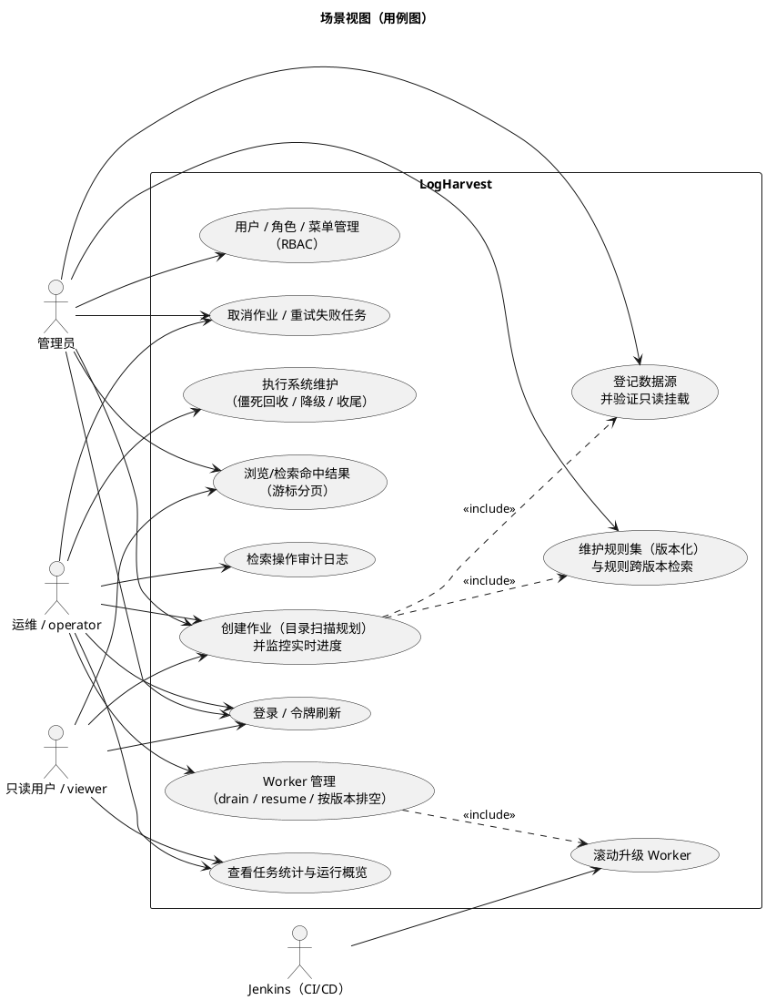
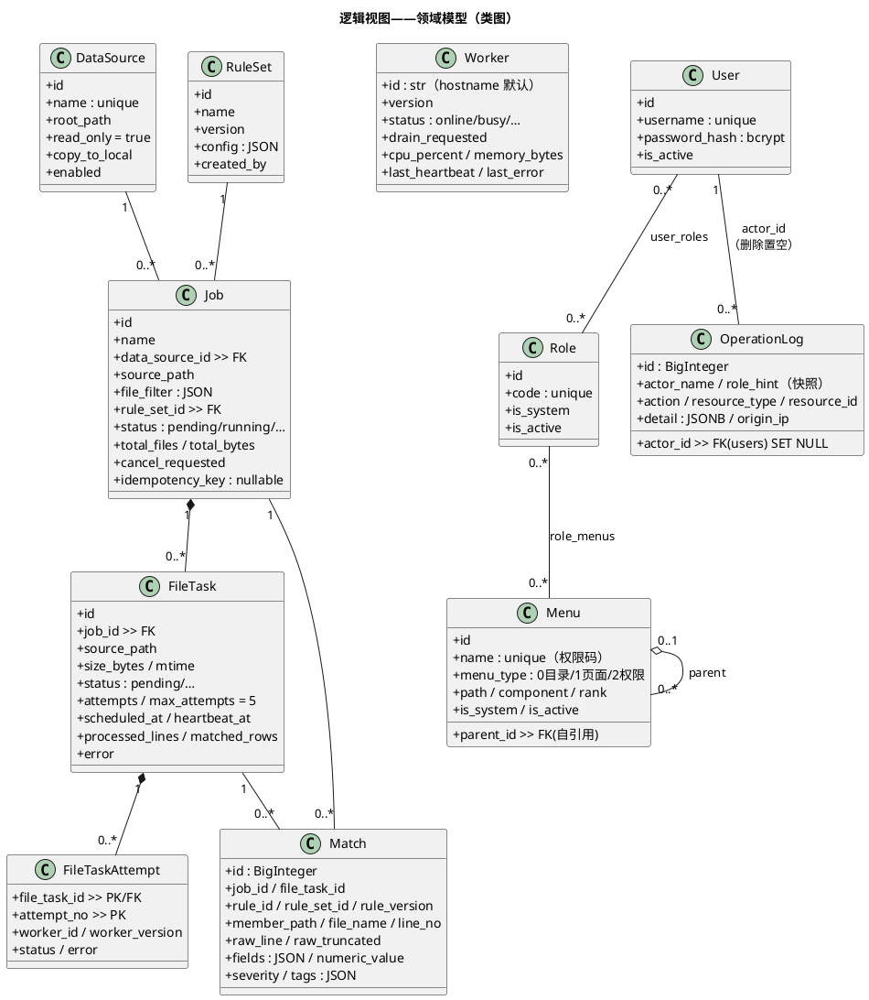
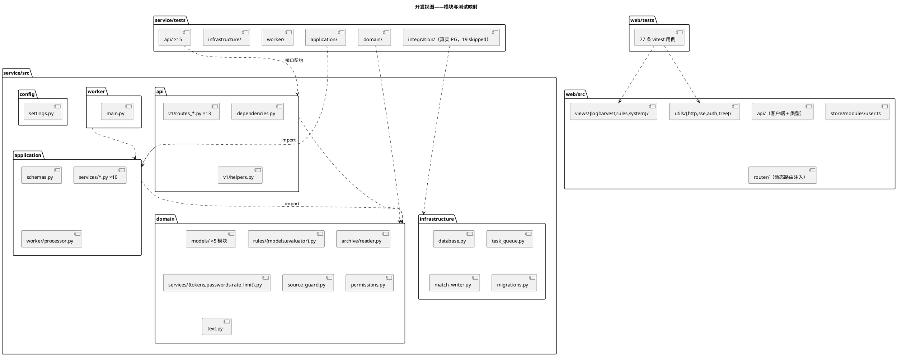
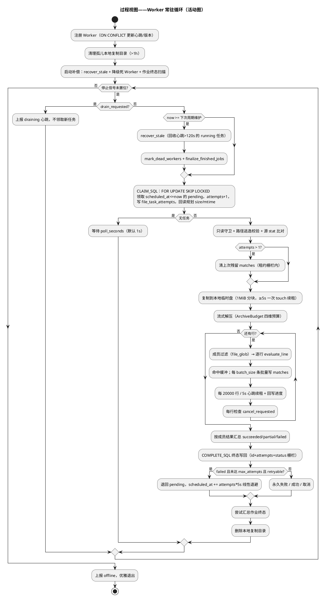
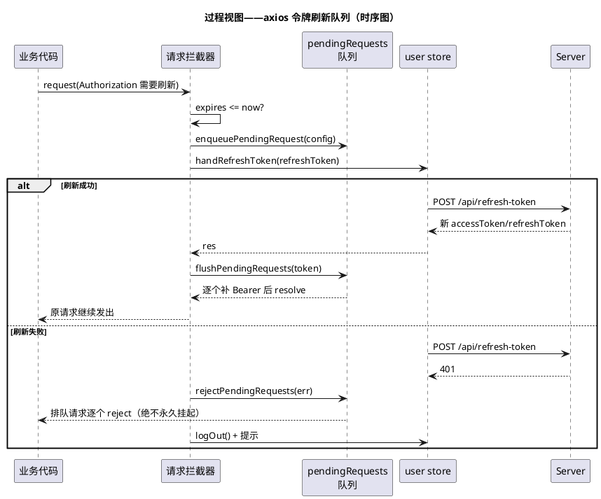

# LogHarvest 4+1 架构视图

> 4+1 模型（Kruchten, 1995）：**场景视图**（+1）驱动，**逻辑 / 开发 / 过程 / 物理**四个视图分别面向功能分解、代码组织、运行时行为与部署拓扑。所有图均为 PlantUML。

---

## 0. 场景视图（+1）——驱动其他四个视图

六个核心场景，每个场景都可在前端界面直接操作：



角色与权限的映射（菜单即权限，19 个权限码）：

| 角色 | 能力边界 |
|---|---|
| admin | 全部（权限解析返回通配 `*:*:*`，不依赖授权表） |
| operator | 作业创建/操作、Worker 操作、维护执行、审计查看；无用户/角色/菜单管理与规则集写入 |
| viewer | 全部只读（作业/命中/统计/Worker 状态）；**无**审计（操作日志含权限拓扑） |

---

## 1. 逻辑视图——功能分解与领域模型

领域模型共 13 张表：业务 7 张、RBAC 5 张、审计 1 张。



领域规则（与持久化同层声明）：

- `file_tasks` 上 `(job_id, source_path)` 唯一——同作业重复扫描天然幂等。
- `jobs` 上 `(created_by, idempotency_key)` 唯一——幂等键由唯一约束兜底。
- `rule_sets` 上 `(name, version)` 唯一——规则集只增版本不覆盖。
- `matches` 只保留三条索引（作业翻页 / 规则时间窗 / 任务追溯），千万级命中下每条索引都是实打实的写放大。

---

## 2. 开发视图——代码组织



工程纪律：

- 后端 `ruff`（E/F/W/I/B/UP/SIM/PERF/RUF/BLE）+ `ruff format` 全绿；`mypy` 覆盖 domain/worker/application.worker/config。
- 前端 `vue-tsc --noEmit` 门禁；纯逻辑一律抽 `.ts` 模块（`format.ts`、`rule-form.ts`、`pendingRequests.ts`、`sse.ts`），这是 77 条单测的前提。
- `agent.md` 强制：任何代码变更提交前必须前后端测试全绿。

---

## 3. 过程视图——运行时行为与并发

### 3.1 Worker 领取循环（单进程视角）



### 3.2 多 Worker 并发（多进程视角）

```plantuml
@startuml
title 过程视图——并发模型（同一队列，N 个进程互不冲突）

database "file_tasks 队列" as q
worker "Worker-1" as w1
worker "Worker-2" as w2
worker "Worker-3" as w3
worker "Worker-4" as w4

w1 -> q : SELECT ... FOR UPDATE SKIP LOCKED\nLIMIT 1
w2 -> q : SELECT ... FOR UPDATE SKIP LOCKED\nLIMIT 1
w3 -> q : SELECT ... FOR UPDATE SKIP LOCKED\nLIMIT 1
w4 -> q : SELECT ... FOR UPDATE SKIP LOCKED\nLIMIT 1
note right of q
  已被锁定的行被其他事务直接跳过：
  四个 Worker 各拿各的任务，无争用、无重复
end note
q --> w1 : task #101（attempts 0→1）
q --> w2 : task #102
q --> w3 : task #103
q --> w4 : task #104
@enduml
```

并发要点：

- 单进程一次只处理一个任务；单机并行 = 多进程（默认 4，最多 6）。
- **租约栅栏**：所有写路径（matches 批量写、清场、终态）都必须先 `touch`（`id + attempts + status='running'`）成功；丢租约立即 `LeaseLost` 中止且不写终态——僵死回收后旧 Worker 的迟到写入全部失效。
- 同机多进程必须唯一 `LOGHARVEST_WORKER_ID`（容器化下取容器 hostname 天然唯一）。

### 3.3 前端令牌刷新（无感续期）



---

## 4. 物理视图——部署拓扑

```plantuml
@startuml
title 物理视图——三个独立 compose 栈部署（deployment diagram，数据归档 /usr1）

node "宿主机（Linux + Docker）" {

  node "栈 logharvest-db\n（deploy/postgres）" as dbstack {
    node "postgres 容器（PG16）\nlogharvest-postgres" as pgc
    folder "/usr1/logharvest/postgres/data\n（PGDATA bind mount）" as pgdata
    folder "/usr1/logharvest/postgres/backup\n（pg_dump 归档，含 Jenkins 升级前备份）" as backup
  }

  node "栈 logharvest-app\n（deploy/server）" as appstack {
    node "web 容器（nginx:1.27）:80" as web {
      artifact "前端静态资源 dist/" as dist
      artifact "nginx.conf（/api 反代、SSE 禁缓冲）" as nconf
    }
    node "server 容器（uvicorn :8000）" as server {
      artifact "FastAPI 应用（启动即迁移+种子）" as app
    }
    folder "/usr1/logharvest/server/logs\n（日志归档位）" as slog
  }

  node "栈 logharvest-worker\n（deploy/worker，可 --scale 到 6）" as workerstack {
    node "worker 容器 ×N" as worker {
      artifact "python -m src.worker" as wproc
      folder "/usr1/logharvest/worker/tmp\n（解压临时盘，任务结束自动清理）" as tmp
    }
  }

  network "logharvest-net（外部网络）" as net
}

node "企业 NAS" as nas {
  folder "/mnt/nas/applogs\n（只读挂载 → 容器 /nas:ro）" as logs
}

node "Jenkins" as jenkins {
  artifact "Jenkinsfile\n门禁→镜像→备份→三栈发布" as jf
}

web --> server : /api/**（HTTP/1.1，代理）
net <-right- pgc
net <-right- server
net <-right- worker
server --> pgc : SQLAlchemy（同步会话）\n经外部网络容器名直连
wproc --> pgc : SKIP LOCKED / 批量写
logs ..> worker : 只读复制
tmp ..> worker : 挂载为 LOGHARVEST_WORK_DIR
pgdata --- pgc
backup --- pgc
jenkins ..> dbstack : 发布 0-2（引导/备份/--wait）
jenkins ..> appstack : 发布 3（直换）
jenkins ..> workerstack : 发布 4（滚动换新+扩容）
@enduml
```

三个栈通过外部网络 `logharvest-net` 互通、互相独立升级；数据库栈以固定容器名 `logharvest-postgres` 提供 DNS。所有可归档数据（PG 数据、备份、Worker 临时盘、日志归档位）统一规划在数据盘 `/usr1/logharvest/`，由 `deploy/init-dirs.sh` 幂等创建。

物理节点的容量与网络要求：

| 节点 | 要求 |
|---|---|
| NAS | 只读导出（NFS/SMB）；LogHarvest 对它零写入 |
| Worker 宿主机 | 本地临时盘 ≥ 20 × 最大压缩包解压量；`/proc/self/mounts` 可读（Linux）以使只读守卫真实生效 |
| PostgreSQL | 命中量千万级：`matches` 按月分区与保留期为后续演进项（设计 §6.6） |
| 网络处理 | 浏览器 → Nginx(80) → server(8000)；SSE 需禁 `proxy_buffering` |

---

## 5. 视图一致性检查表

| 场景 | 逻辑 | 开发 | 过程 | 物理 |
|---|---|---|---|---|
| 创建作业 | Job/FileTask 建模 | `services/jobs.py` + `routes_jobs.py` | §core-logic 规划时序 | server → PG |
| Worker 消费 | FileTask 状态机 + 尝试历史 | `worker/main.py` + `processor.py` | §3.1/§3.2 活动/并发 | worker → NAS/tmp/PG |
| 实时进度 | —（读聚合） | `routes_events.py` + `utils/sse.ts` | SSE 分帧与降级轮询 | Nginx 禁缓冲 |
| 权限控制 | Menu/Role/User 建模 | `permissions.py` 单一来源 | 登录/刷新时序 | server → PG |
| 滚动升级 | Worker.drain_requested | `routes_workers.py` | Jenkins 流水线阶段 | 双版本并存 → 旧清零 |
