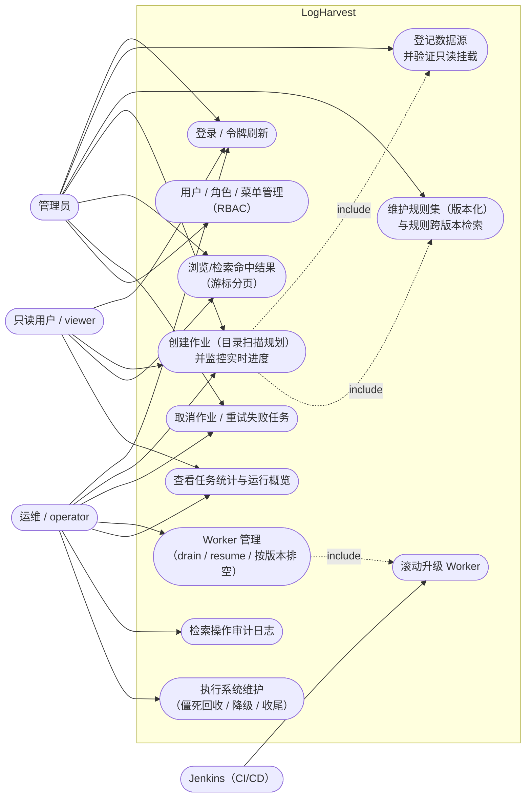
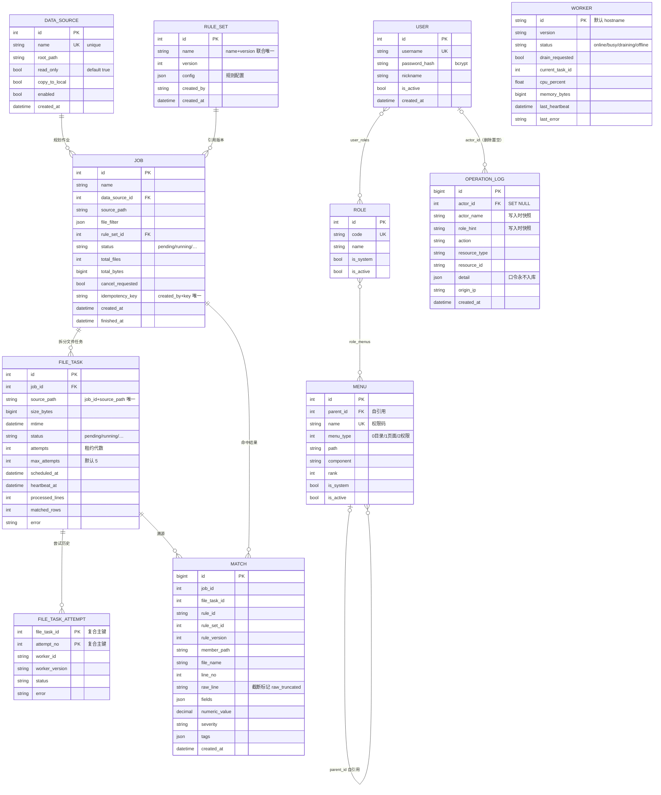
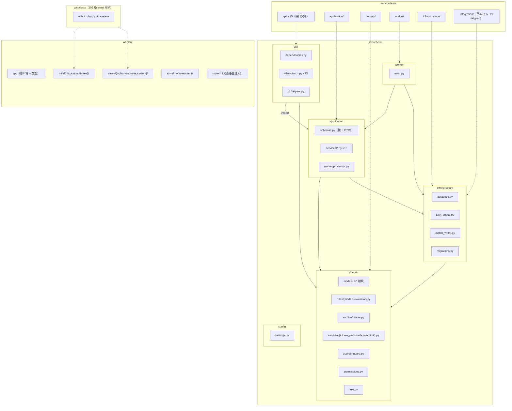
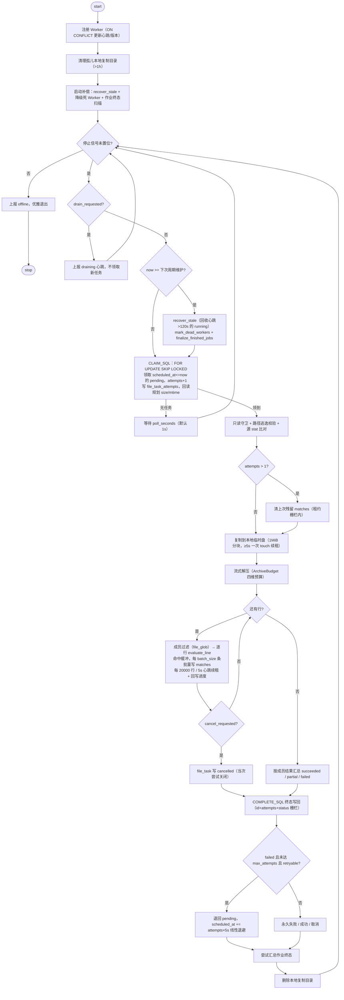
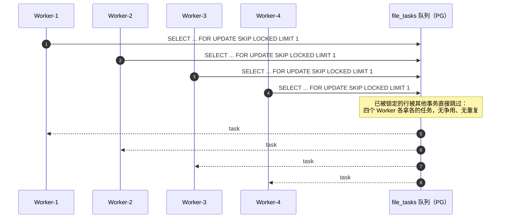
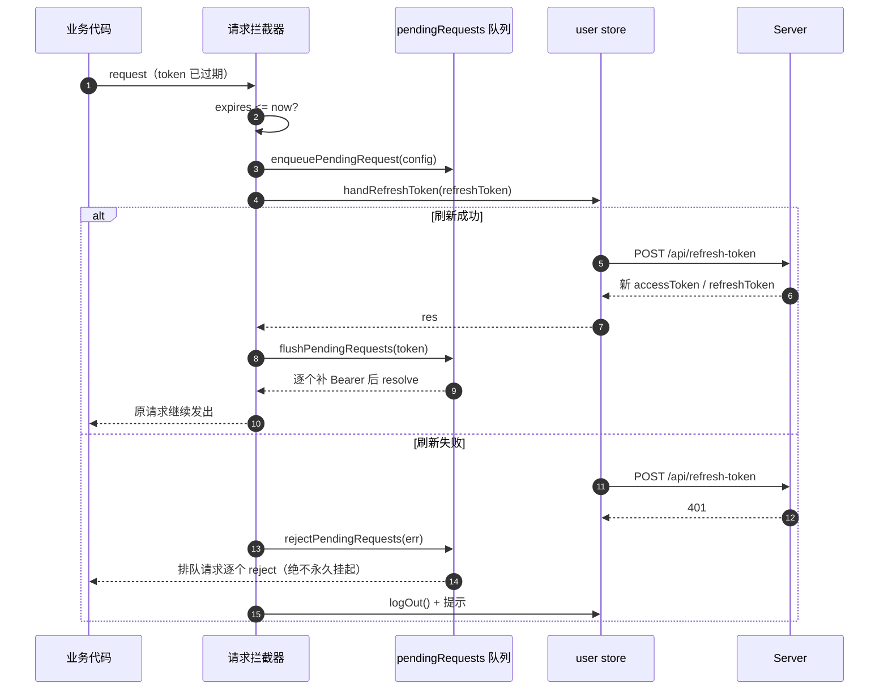
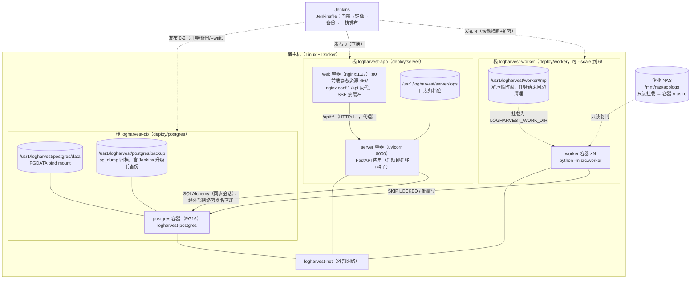

# LogHarvest 4+1 架构视图

> 4+1 模型（Kruchten, 1995）：**场景视图**（+1）驱动，**逻辑 / 开发 / 过程 / 物理**四个视图分别面向功能分解、代码组织、运行时行为与部署拓扑。所有图均为 Mermaid，GitHub / GitLab 可直接渲染。

---

## 0. 场景视图（+1）——驱动其他四个视图

六个核心场景，每个场景都可在前端界面直接操作：

角色与权限的映射（菜单即权限，19 个权限码）：

| 角色 | 能力边界 |
|---|---|
| admin | 全部（权限解析返回通配 `*:*:*`，不依赖授权表） |
| operator | 作业创建/操作、Worker 操作、维护执行、审计查看；无用户/角色/菜单管理与规则集写入 |
| viewer | 全部只读（作业/命中/统计/Worker 状态）；**无**审计（操作日志含权限拓扑） |

---

## 1. 逻辑视图——功能分解与领域模型

领域模型共 13 张表：业务 7 张、RBAC 5 张、审计 1 张。

领域规则（与持久化同层声明）：

- `file_tasks` 上 `(job_id, source_path)` 唯一——同作业重复扫描天然幂等。
- `jobs` 上 `(created_by, idempotency_key)` 唯一——幂等键由唯一约束兜底。
- `rule_sets` 上 `(name, version)` 唯一——规则集只增版本不覆盖。
- `matches` 只保留三条索引（作业翻页 / 规则时间窗 / 任务追溯），千万级命中下每条索引都是实打实的写放大。

---

## 2. 开发视图——代码组织

工程纪律：

- 后端 `ruff`（E/F/W/I/B/UP/SIM/PERF/RUF/BLE）+ `ruff format` 全绿；`mypy` 覆盖 domain/worker/application.worker/config。
- 前端 `vue-tsc --noEmit` 门禁；纯逻辑一律抽 `.ts` 模块（`format.ts`、`rule-form.ts`、`pendingRequests.ts`、`sse.ts`），这是 102 条单测的前提。
- `agent.md` 强制：任何代码变更提交前必须前后端测试全绿。

---

## 3. 过程视图——运行时行为与并发

### 3.1 Worker 领取循环（单进程视角）

### 3.2 多 Worker 并发（多进程视角）

并发要点：

- 单进程一次只处理一个任务；单机并行 = 多进程（默认 4，最多 6）。
- **租约栅栏**：所有写路径（matches 批量写、清场、终态）都必须先 `touch`（`id + attempts + status='running'`）成功；丢租约立即 `LeaseLost` 中止且不写终态——僵死回收后旧 Worker 的迟到写入全部失效。
- 同机多进程必须唯一 `LOGHARVEST_WORKER_ID`（容器化下取容器 hostname 天然唯一）。

### 3.3 前端令牌刷新（无感续期）

---

## 4. 物理视图——部署拓扑

三个栈通过外部网络 `logharvest-net` 互通、互相独立升级；数据库栈以固定容器名 `logharvest-postgres` 提供 DNS。所有可归档数据（PG 数据、备份、Worker 临时盘、日志归档位）统一规划在数据盘 `/usr1/logharvest/`，由 `deploy/init-dirs.sh` 幂等创建。

物理节点的容量与网络要求：

| 节点 | 要求 |
|---|---|
| NAS | 只读导出（NFS/SMB）；LogHarvest 对它零写入 |
| Worker 宿主机 | 本地临时盘 ≥ 20 × 最大压缩包解压量；`/proc/self/mounts` 可读（Linux）以使只读守卫真实生效 |
| PostgreSQL | 命中量千万级：`matches` 按月分区与保留期为后续演进项（设计 §6.6） |
| 网络处理 | 浏览器 → Nginx(80) → server(8000)；SSE 需禁 `proxy_buffering` |

---

## 5. 视图一致性检查表

| 场景 | 逻辑 | 开发 | 过程 | 物理 |
|---|---|---|---|---|
| 创建作业 | Job/FileTask 建模 | `services/jobs.py` + `routes_jobs.py` | §core-logic 规划时序 | server → PG |
| Worker 消费 | FileTask 状态机 + 尝试历史 | `worker/main.py` + `processor.py` | §3.1/§3.2 活动/并发 | worker → NAS/tmp/PG |
| 实时进度 | —（读聚合） | `routes_events.py` + `utils/sse.ts` | SSE 分帧与降级轮询 | Nginx 禁缓冲 |
| 权限控制 | Menu/Role/User 建模 | `permissions.py` 单一来源 | 登录/刷新时序 | server → PG |
| 滚动升级 | Worker.drain_requested | `routes_workers.py` | Jenkins 流水线阶段 | 双版本并存 → 旧清零 |
