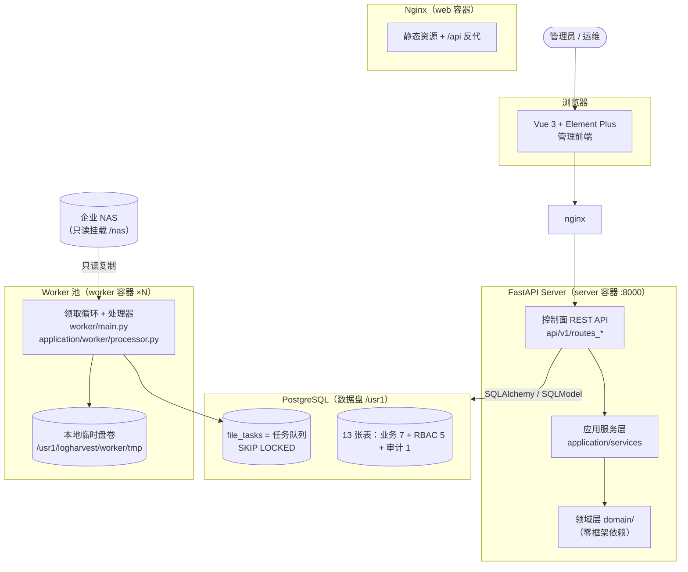
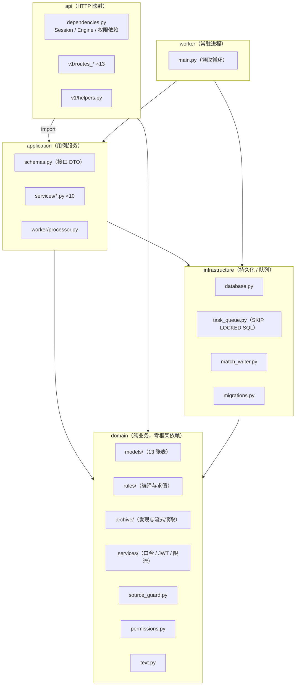
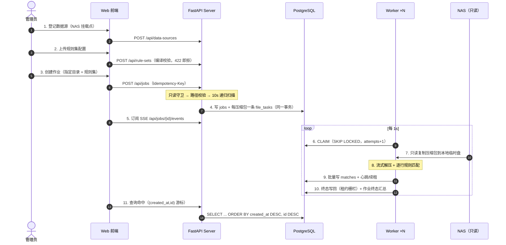

# LogHarvest 整体设计架构

> 读者：第一次接触本仓库的工程师。读完应能回答"系统是什么、由什么组成、数据怎么流、为什么这样设计"。
> 所有图表使用 **Mermaid** 编写，可在 GitHub / GitLab 及主流 Markdown 渲染器中直接渲染。

## 1. 系统定位

LogHarvest 是**压缩日志规则提取平台**：面向企业 NAS 上的海量压缩日志（单批 500 GB / 1000+ 压缩包 / 千万行级单文件），管理员在 Web 上配置数据源与规则集、指定要分析的 NAS 目录，Server 递归扫描把每个压缩包拆成文件任务，多 Worker 并发**复制 → 流式解压 → 逐行规则匹配 → 结果入库**，最后在 Web 上查进度、重试历史、失败原因与命中结果。

## 2. 不可妥协的设计约束

| 约束 | 来源 | 落点 |
|---|---|---|
| PostgreSQL 是唯一事实源（元数据、队列、结果同库，不引入 Celery/ES/ClickHouse） | 技术选型评估 §4 | `SKIP LOCKED` 队列（`infrastructure/task_queue.py`） |
| NAS 原始数据全程只读：不删、不移、不重命名、不写入 | 规格 §7.2 | 只读守卫 `domain/source_guard.py`（挂载表 + st_mode 弱证据，`enforce` 判可写即拒绝处理） |
| 单机内存 16 GB、临时盘容纳 20 个最大压缩包 | 规格 §2 | 解压预算 `ArchiveBudget`（单成员 1 GiB / 整包 4 GiB / 1 万成员 / 膨胀比 500） |
| 任务可观测、可重试、可排障 | 规格 §7 | 尝试历史、心跳租约、线性退避、僵死回收、幂等栅栏全部落库 |

## 3. 三服务架构



三个进程角色共享同一个 PostgreSQL，彼此之间**没有任何直接通信**：Server 只写元数据，Worker 只通过队列 SQL 领取任务，进度经 `file_tasks` 状态与 SSE 轮询读回。

## 4. 技术栈与选型理由

| 层 | 选择 | 理由 |
|---|---|---|
| 前端 | Vue 3 + TypeScript + Element Plus + Pinia（派生自 vue-pure-admin，MIT） | 复用成熟中后台基座，业务代码聚焦六个功能屏 + 系统管理 |
| Web Server | FastAPI + SQLModel + Pydantic v2 | 同步 SQLAlchemy 会话模型简单可靠；Pydantic 承担接口契约 |
| 任务队列 | PostgreSQL `FOR UPDATE SKIP LOCKED` | 500 GB 批次天然与结果同库，事务一致免引入新组件 |
| 规则匹配 | `regex` 库（带超时）+ `pathspec`（gitwildmatch 成员过滤） | 正则可设 `timeout_ms` 防灾难回溯 |
| 迁移 | Alembic（0001–0005） | `create_all` 捷径只允许出现在 0001 基线；测试逐列比对迁移与 metadata |
| Worker | Python 多进程（一进程一任务） | 解压/解析是 CPU+IO 密集；进程隔离避免 GIL 与内存互扰 |
| 认证 | JWT（HS256）+ bcrypt + RBAC（菜单即权限） | 无服务端会话；权限码单一来源 `domain/permissions.py` |
| 可观测 | structlog 结构化日志 + 尝试历史表 | 失败原因、Worker 资源、任务生命周期全部可查 |

## 5. 分层架构（后端）



依赖方向恒为 `api → application → domain ← infrastructure`，`worker → application`。两条纪律由约定与测试共同守卫：

1. **应用层不 import FastAPI**：服务层用 `RbacError` / `JobCreateError` / `RetryNotPermitted` 等业务异常声明语义（状态码 + detail），路由层统一翻译成 `HTTPException`。
2. **domain 不依赖任何框架**：可在无 Web/DB 的纯单测中覆盖（`tests/domain/`）。

## 6. 端到端数据流



## 7. 目录结构

```
think/
├── service/                  # 后端（Python 3.12 + uv）
│   ├── src/
│   │   ├── api/              # 路由与依赖（dependencies.py / v1/routes_*）
│   │   ├── application/      # 用例服务 + 接口 DTO（schemas.py）+ worker 处理器
│   │   ├── domain/           # 纯业务：models/rules/archive/services/text.py
│   │   ├── infrastructure/   # 引擎、SKIP LOCKED 队列、批量写入、迁移
│   │   ├── worker/           # 常驻循环（python -m src.worker）
│   │   └── config/           # pydantic-settings 配置（强校验）
│   ├── alembic/              # 0001 基线 ~ 0005 operation_logs
│   ├── tests/                # 500 条用例（api/application/domain/worker/integration）
│   └── Dockerfile            # server / worker 双 target 多阶段构建
├── web/                      # 前端（pnpm + Vite 8 + Vue 3.5）
│   ├── src/api/              # 按域拆分的 API 客户端与类型（契约注释）
│   ├── src/views/            # logharvest（六屏）/ rules / system
│   ├── src/utils/http/       # axios 封装、token 刷新队列
│   ├── tests/                # vitest 77 条用例
│   ├── Dockerfile + nginx.conf
│   └── LICENSE               # vue-pure-admin 上游 MIT 原文
├── deploy/                   # 三个独立 compose 栈 + 数据盘引导
│   ├── postgres/             # 数据库栈（数据/备份归档 /usr1，可选每日备份容器）
│   ├── server/               # 控制面栈（server + web，无状态直换）
│   ├── worker/               # Worker 栈（--scale 扩容，临时盘在 /usr1）
│   └── init-dirs.sh          # /usr1 目录规划 + logharvest-net 网络（幂等）
├── Jenkinsfile               # 门禁 → 镜像 → 升级前备份 → 三栈发布 → 冒烟
├── agent.md                  # AI 协作测试门禁（强制）
└── docs/                     # 本文档集 + 历史设计/评估归档
```

## 8. 关键设计决策速查

| 决策 | 一句话理由 | 详见 |
|---|---|---|
| 队列放 PostgreSQL 而非 Redis/Celery | 结果、元数据、队列同库，领取/心跳/终态在同一个事务口径里 | `infrastructure/task_queue.py` |
| 列表响应是裸数组、无 total | 窗口式翻页契约，前端 8 个视图统一执行；概览接口供分组计数 | `queries.py` |
| 命中查询用 `(created_at, id)` 游标 | 千万级命中下 offset 翻页会退化成全表排序 | `routes_matches.py` |
| 菜单即权限（`menus.menu_type=2` 的 name 即权限码） | 权限码单一来源，声明/种子/前端三处共用，测试钉住一致性 | `domain/permissions.py` |
| 登录失败也跑一次 bcrypt | 消除"未知用户"分支 ~450ms 对 ~5ms 的用户名枚举时序侧信道 | `routes_auth.py` |
| 审计行与业务写同事务，审计失败只告警 | 业务回滚不留假案；留痕不完整可补，业务因审计挂掉不可接受 | `application/services/audit.py` |
| Worker 无状态、升级靠 drain | Web 只做状态/版本/drain；滚动替换由 Jenkins + Compose 执行 | `docs/deployment-jenkins.md` |

## 9. 相关文档

- [4+1 架构视图](architecture-4plus1.md) — 场景/逻辑/开发/过程/物理
- [核心逻辑说明](core-logic.md) — 规划、队列租约、规则引擎、终态汇总、认证 RBAC、审计
- [本地开发指导](local-development.md)
- [Docker 部署说明](deployment-docker.md) / [Jenkins 自动化说明](deployment-jenkins.md)
- 历史设计归档：`docs/superpowers/specs/`（主设计、技术选型、RBAC、菜单 IA、M3 多行记录）
