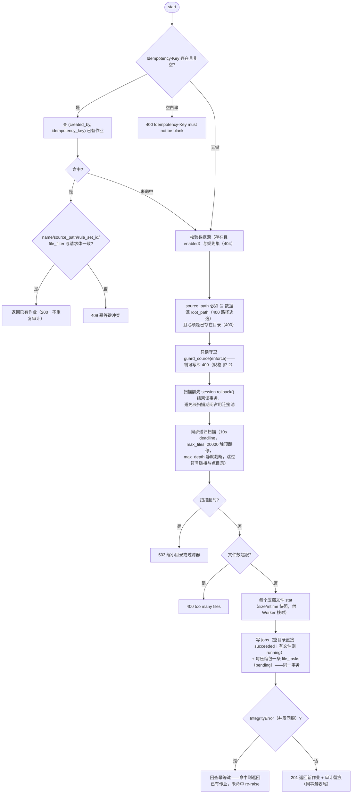
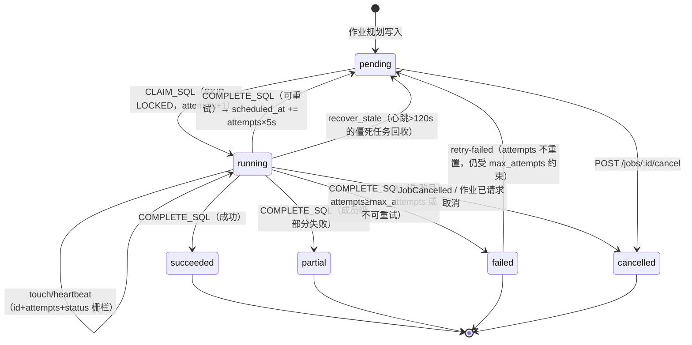
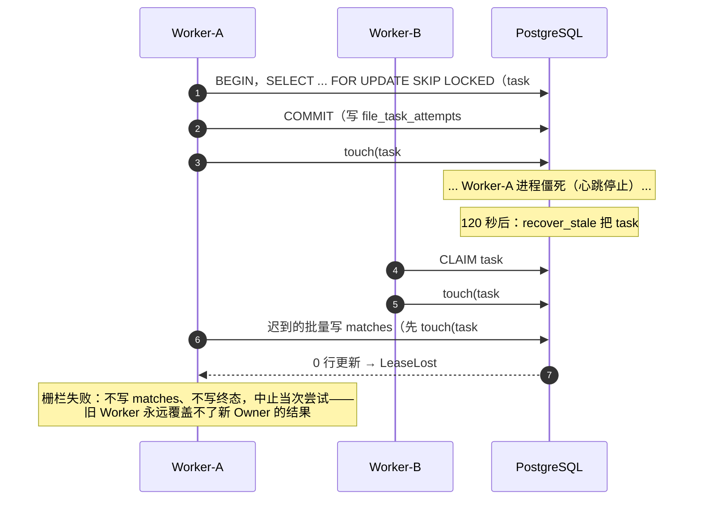
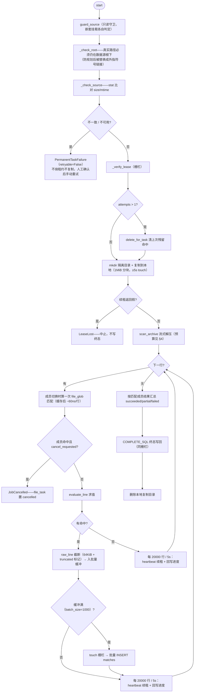
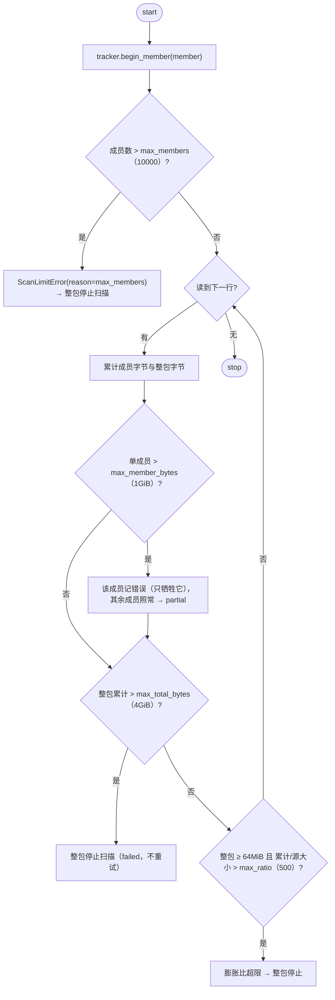
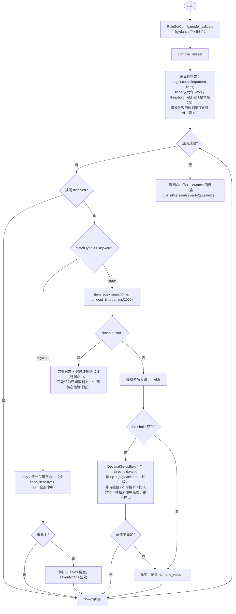
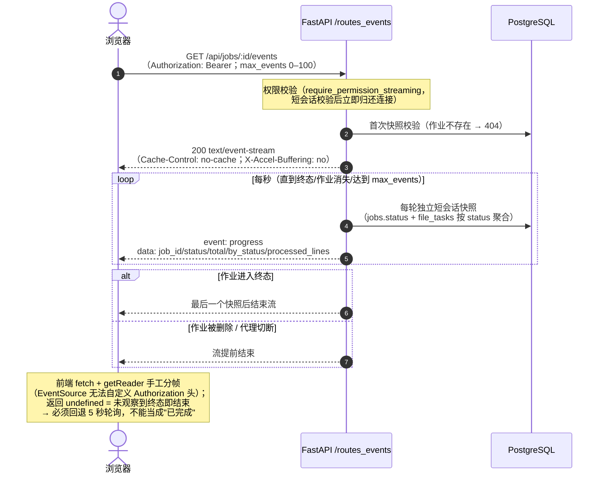
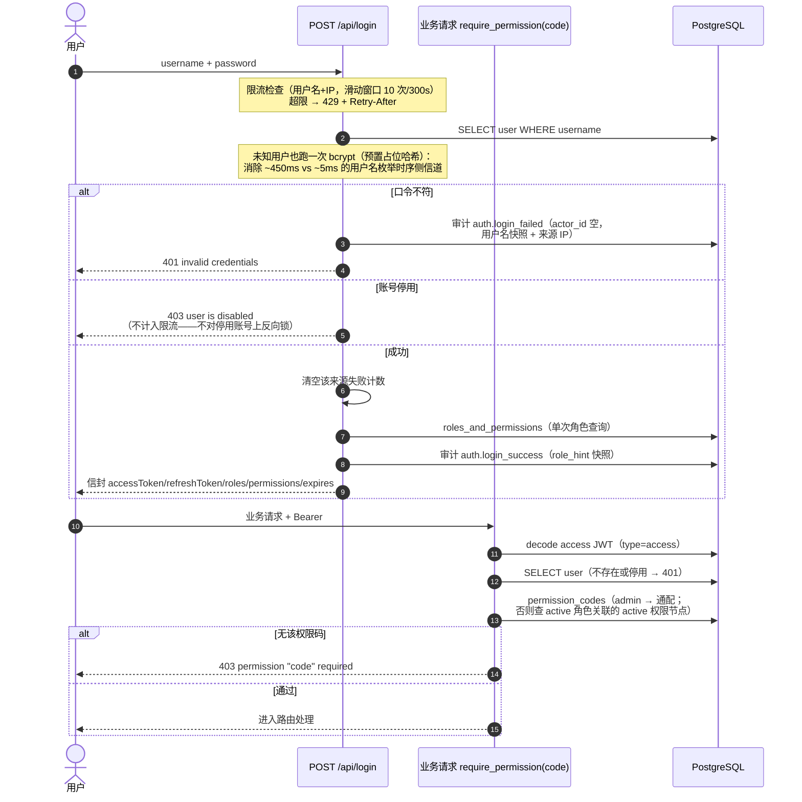
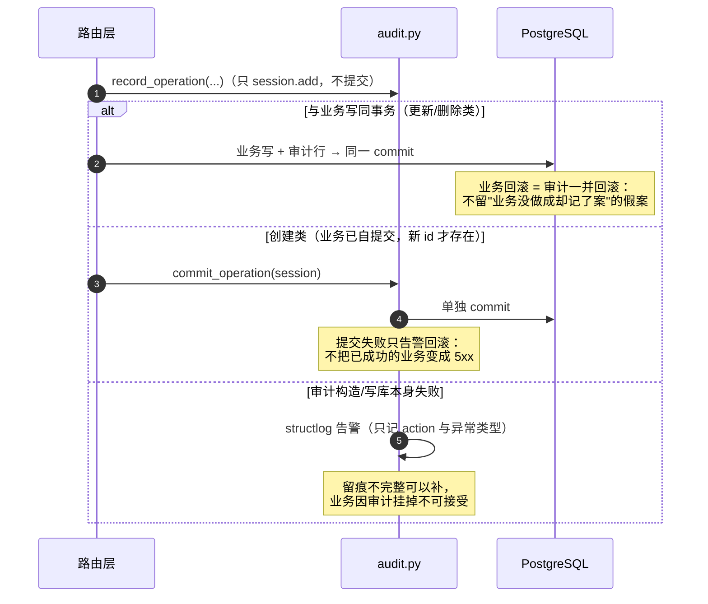

# LogHarvest 核心逻辑说明

> 逐条解释系统的八块核心逻辑：**为什么这样设计、边界在哪、失败时发生什么**。配套代码位置均可直接点击跳转。所有图均为 Mermaid，GitHub 可直接渲染。

## 目录

1. [作业创建与规划（含幂等）](#1-作业创建与规划)
2. [任务队列与租约栅栏](#2-任务队列与租约栅栏)
3. [Worker 执行与容错（成员级 partial）](#3-worker-执行与容错)
4. [解压预算（压缩炸弹防护）](#4-解压预算)
5. [规则引擎](#5-规则引擎)
6. [作业终态汇总与取消/重试语义](#6-作业终态汇总与取消重试语义)
7. [SSE 实时进度](#7-sse-实时进度)
8. [认证、RBAC 与审计](#8-认证rbac-与审计)

---

## 1. 作业创建与规划

代码：`application/services/jobs.py`（服务）+ `api/v1/routes_jobs.py`（HTTP 映射 + 审计）。



设计要点：

- **幂等三态**：同键同体 → `200` 回放；同键不同体 → `409`；无键 → 正常创建。并发插入靠 `jobs(created_by, idempotency_key)` 唯一约束兜底，冲突后回查。
- **`file_filter.suffixes` 求交**：显式传入的后缀集合先与压缩包后缀集合（zip/tar 系/gz/bz2/xz）求交，交集为空（例如只传 `.log`）返回 `400`——原始文本不会混进压缩任务。
- **规划快照**：`size_bytes`/`mtime` 在规划时落库；Worker 执行前核对，不一致判永久失败（重试只会同样失败）。

---

## 2. 任务队列与租约栅栏

代码：`infrastructure/task_queue.py`（全部 PostgreSQL 专有 SQL）。

### 2.1 file_tasks 状态机



### 2.2 领取与租约栅栏（时序）



要点：

- **`attempts` 是租约代数**：所有写路径（清场、批量写、终态）前置 `touch`（`id + attempts + status='running'` 三元栅栏）；回收/接管后代数变化，旧代写入全部失效。
- **线性退避**：可重试失败回 `pending` 时 `scheduled_at = now() + attempts × 5s`；`CLAIM_SQL` 只领取 `scheduled_at <= now()` 的任务。
- **回收兜底**：Worker 启动时 + 每 300 秒 + 服务端 `POST /api/system/maintenance` 都会执行 `recover_stale`，覆盖"进程不在了没人清场"的场景。

---

## 3. Worker 执行与容错

代码：`application/worker/processor.py`（单任务处理器）+ `worker/main.py`（领取循环）。

### 3.1 单任务处理



### 3.2 成员级容错（为什么会有 partial）

| 场景 | 行为 |
|---|---|
| zip 单成员损坏 | 记录 `ArchiveMemberError` 后**继续读剩余成员**；匹配成员至少一个完整读完 → `partial` |
| 流式 tar 成员损坏 | 无法 seek 越过 → 该处停止（`scan_incomplete`）；之前已读的成员有效 → `partial` |
| tar 缺零结束块 | tarfile 会把截断当 EOF，扫描结束额外校验零块，缺失标记 `scan_incomplete` 防漏读 |
| 被排除成员损坏且不影响读取 | 不计入状态（zip 可跳过）；流式 tar 停止点之后可能还有匹配成员，因此始终计入 |
| 所有匹配成员失败 | `failed`；全部以 `retryable=False` 写终态，**不自动重试**（重试同样失败，只烧 max_attempts） |

错误摘要写入 `file_tasks.error`，每次尝试独立记录在 `file_task_attempts`（尝试历史抽屉可查）。

---

## 4. 解压预算

代码：`domain/archive/reader.py` 的 `ArchiveBudget` + `_BudgetTracker`。



动机：zip 声明的 `file_size` 可任意伪造，**只有实际解压出来的字节算数**——预算在流式读取路径上实时计数，这是唯一能在"读到一半"发现炸弹的位置。低于 64 MiB 不参与膨胀比判定，避免误伤正常小文件。

---

## 5. 规则引擎

代码：`domain/rules/models.py`（配置模型）+ `domain/rules/evaluator.py`（编译与求值）。



规则配置形状（`RuleSetConfig`）：

```jsonc
{
  "name": "生产错误捕获",
  "file_glob": "**/*.log",            // gitwildmatch，成员级过滤
  "encoding": "utf-8",                // 首选编码
  "fallback_encoding": "gb18030",     // 严格解码失败后的回退
  "rules": [
    { "id": "err-500", "match": { "type": "keyword", "any": ["FATAL", "ERROR"],
      "all": [], "case_sensitive": false } },
    { "id": "cpu-high", "match": { "type": "regex", "pattern": "cpu=(?P<cpu>\\d+)",
      "flags": "i", "timeout_ms": 50 },
      "threshold": { "field": "cpu", "op": "gt", "value": "90" } }
  ]
}
```

`keyword.any` 与 `keyword.all` 互斥；正则阈值依赖命名分组提取；字符串形式的 `value` 避免 Decimal 精度丢失。

---

## 6. 作业终态汇总与取消/重试语义

- **由谁汇总**：完成最后一个任务的 Worker 通过 `finalize_job` 收尾；每 300 秒与服务端维护入口做周期兜底（覆盖无完成回调的路径）。
- **汇总规则**：全部任务 `succeeded` → `succeeded`；混有 `failed/partial` → `failed`/`partial`；`cancel_requested` 为真 → `cancelled`；存在 `pending/running` → 继续 `running`。
- **取消**：`POST /jobs/{id}/cancel` 把 `pending` 置 `cancelled` + `cancel_requested=true`；无 running 任务立即终态，否则等 Worker 在行循环里感知（每行一次查询）。终态作业的取消是幂等空操作。
- **手动重试**：`retry-failed` 只搬 `failed` 行（单次上限 200，`remaining_failed` 可见）、`attempts` 不重置（防死循环刷库）、已取消作业直接 `409`（`CLAIM_SQL` 永不再领取，重新入队只会永久滞留）。
- **Worker drain**：`drain_requested=true` 后只心跳不领取；`drain-version` 按版本批量打标（离线 Worker 只记标记不改状态），是 Jenkins 滚动升级的基础原语。

---

## 7. SSE 实时进度

代码：`api/v1/routes_events.py`（服务端）+ `web/src/utils/sse.ts`（客户端）。



Nginx 反代必须 `proxy_buffering off` + 长 `proxy_read_timeout`（见 `web/nginx.conf`），否则帧会被缓冲到流结束一次性下发，前端退化为轮询。

---

## 8. 认证、RBAC 与审计

### 8.1 登录与权限解析



RBAC 三条设计纪律：

1. **权限码单一来源** `domain/permissions.py`：路由声明、启动种子（3 目录/13 页面/19 权限节点）、前端按钮权限共用一份常量；`test_every_declared_permission_code_is_seeded` 钉住"声明了却没种子"的漂移。
2. **菜单即权限**：`menus.menu_type=2` 的 `name` 就是权限码；角色授权 = role_menus；`GET /api/auth/routes` 把菜单树转成前端动态路由（无可见子页面的目录剔除）。
3. **最后一名 active admin 保护**：停用自己 / 摘除 admin 角色 / 删除 admin 均被拒绝（409/400）。

### 8.2 操作审计



行内容：`actor_id`（删除账号时外键 SET NULL + 显式置空兜底 SQLite）、`actor_name`/`role_hint` 写入时快照（删号不抹责任链）、`action`（`user.create` / `job.cancel` / `auth.login_failed`…）、`detail`（变更前后摘要，**口令永不入库**）、`origin_ip`。表只追加：无更新接口、无删除接口。

---

## 附：已知边界（有意的取舍，均已文档化）

| 边界 | 说明 |
|---|---|
| 登录限流为进程内计数 | 多副本实际放行量 = 阈值 × 副本数（`rate_limit.py` 文件头） |
| 正则超时静默跳过且不计数 | 该行漏命中仍可能 `succeeded`（核心链路评估 P1-7，M3 议题） |
| `max_matches_per_task` 声明未强制 | 空关键字/空正则可匹配全部行（核心链路 P0-3，修复方案见评估文档） |
| `matches` 未按月分区 | 千万级命中下需按设计 §6.6 演进 |
| 规则索引查询期展平 JSON | 当前版本量级可接受，代价记在主设计 §15 |
