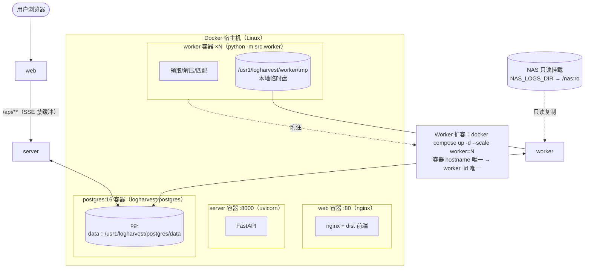

# LogHarvest Docker 部署说明

> 一台 Linux 宿主机 + Docker（含 Compose v2.23+，支持 `up --wait`）即可部署完整系统。
> 部署形态为**三个独立 compose 栈**——数据库、控制面（server+web）、Worker 各自独立部署、独立升级；
> **所有可归档数据统一规划在数据盘 `/usr1/logharvest/`**。

## 1. 三个独立部署栈

| 栈 | compose 文件 | 内容 | 数据落点（/usr1） |
|---|---|---|---|
| 数据库 | `deploy/postgres/docker-compose.yml` | PostgreSQL 16 + 可选每日备份容器（`--profile backup`） | `/usr1/logharvest/postgres/data`（数据）、`/usr1/logharvest/postgres/backup`（pg_dump 归档） |
| 控制面 | `deploy/server/docker-compose.yml` | FastAPI server（含 Alembic 迁移 + RBAC 种子）+ Nginx 前端 | `/usr1/logharvest/server/logs`（日志归档位） |
| Worker | `deploy/worker/docker-compose.yml` | 领取/解压/匹配进程池（`--scale worker=N`） | `/usr1/logharvest/worker/tmp`（解压临时盘，任务结束自动清理） |

三个栈之间**零 compose 依赖**，通过预先创建的外部 Docker 网络 `logharvest-net` 互通；数据库栈以固定容器名 `logharvest-postgres` 提供 DNS。任何一栈都可以独立重启/升级/回滚。



## 2. /usr1 数据盘目录规划

由 `deploy/init-dirs.sh`（幂等）创建：

| 目录 | 内容 | 属主 | 说明 |
|---|---|---|---|
| `/usr1/logharvest/postgres/data` | PostgreSQL 数据目录 | uid 70（pg alpine） | `PGDATA` 子目录结构由镜像初始化 |
| `/usr1/logharvest/postgres/backup` | pg_dump 归档 | uid 70 | Jenkins 升级前自动备份 + 定时备份（`--profile backup`）共用 |
| `/usr1/logharvest/worker/tmp` | 解压临时盘 | root（750） | 容器内挂载为 `/local-tmp`；按任务隔离、任务结束自动删除 |
| `/usr1/logharvest/server/logs` | Server 日志归档位 | root（750） | 当前日志走 stdout（docker logs / 收集器）；需要落盘时挂给容器 |

环境变量文件（`.env`，含密钥）保留在仓库检出目录 `deploy/<栈>/.env`，**不入 git**；若安全策略要求配置也落数据盘，可将三个 `.env` 移到 `/usr1/logharvest/deploy/<栈>/.env` 并同步调整 Jenkinsfile 中的 `--env-file` 路径。

## 3. 镜像与编排物

| 文件 | 作用 |
|---|---|
| `service/Dockerfile` | 后端多阶段构建：`builder`（uv 同步依赖）→ `server` / `worker` 两个 target；镜像内含 Alembic 迁移，启动时自动 `upgrade head` + RBAC 种子；**非 root uid 10001 运行** |
| `web/Dockerfile` | 前端两阶段：node:22 `pnpm build` → nginx:1.27-alpine 托管 `dist/`；**非 root nginx 监听 8080**（宿主机端口由 `WEB_PORT` 映射，默认 80） |
| `web/nginx.conf` | 完整主配置（pid/缓存落 /tmp 支持非 root）；SPA 回退；`/api/**` 反代；**SSE 禁缓冲 + 1h 读超时**；安全响应头 nosniff / SAMEORIGIN / Referrer-Policy（CSP 模板注释待浏览器验证） |
| `deploy/init-dirs.sh` | /usr1 目录规划 + 属主 + 外部网络（幂等） |
| `deploy/<栈>/.env.example` | 各栈环境变量样例 |
| `Jenkinsfile` | 门禁 → 镜像 → 升级前备份 → 三栈发布 → 冒烟 |

## 4. 首次部署（手工执行一次，之后交给 Jenkins）

```bash
# 0) 克隆仓库；宿主机安装 Docker + Compose v2（--wait 需 v2.23+）
git clone git@github.com:taoweidong/logharvest.git && cd logharvest

# 1) 数据盘目录规划 + 跨栈网络（幂等，可重复执行）
sudo bash deploy/init-dirs.sh

# 2) 数据库栈
cp deploy/postgres/.env.example deploy/postgres/.env
vi deploy/postgres/.env                        # 填 POSTGRES_PASSWORD
docker compose -f deploy/postgres/docker-compose.yml \
  --env-file deploy/postgres/.env up -d --wait
docker inspect --format '{{.State.Health.Status}}' logharvest-postgres   # healthy

# 3) 控制面栈（server 启动自动迁移建表 + RBAC 种子 + 管理员建号）
cp deploy/server/.env.example deploy/server/.env
vi deploy/server/.env                          # 填 JWT 密钥与 LOGHARVEST_ADMIN_PASSWORD
docker compose -f deploy/server/docker-compose.yml \
  --env-file deploy/server/.env up -d --wait

# 4) Worker 栈
cp deploy/worker/.env.example deploy/worker/.env
vi deploy/worker/.env                          # 填 NAS_LOGS_DIR 与数据库口令
docker compose -f deploy/worker/docker-compose.yml \
  --env-file deploy/worker/.env up -d --scale worker=4

# 5) 冒烟
curl -fsS http://localhost:8000/api/health     # {"status":"ok","service":"logharvest"}
curl -fsS http://localhost/                    # 前端首页
```

登录：`http://localhost/`，账号 `admin` / `LOGHARVEST_ADMIN_PASSWORD`。

**管理员账号需要一次性手动种子**（应用启动只跑 Alembic 迁移 + RBAC 菜单/角色种子，不创建用户；见 `src/main.py` 的 lifespan 与 `api-contract` §2.5）：

```bash
docker compose -f deploy/server/docker-compose.yml --env-file deploy/server/.env \
  exec server python -m scripts.seed_admin
```

脚本幂等，可重复执行；`LOGHARVEST_ADMIN_PASSWORD` 已在 compose 的环境里，无需再传。**注意**：已存在的同名用户不会被改密码——换口令要直接改库或换用户名，重复跑种子无效。

**启动顺序**：数据库栈 → 控制面栈 → Worker 栈。Worker 先于数据库启动也不会出错（`restart: unless-stopped` 会带动重试），但按此顺序最干净。

## 5. 环境变量速查

各栈只读自己 `.env`；跨栈共享的只有数据库凭据与外部网络名。

| 栈 | 变量 | 必填 | 说明 |
|---|---|---|---|
| postgres | `POSTGRES_PASSWORD` | ✅ | 缺省时 compose 直接报错退出 |
| postgres | `PG_DATA_DIR` / `PG_BACKUP_DIR` | 建议 | 默认即 /usr1 规划路径，改路径需同步 init-dirs.sh |
| postgres | `BACKUP_SCHEDULE` / `BACKUP_KEEP_DAYS` | 可选 | `--profile backup` 时的每日备份计划与保留天数（默认 @daily / 14 天） |
| server | `LOGHARVEST_JWT_SECRET_KEY` | ✅ | ≥32 字符；`python -c "import secrets; print(secrets.token_urlsafe(48))"` |
| server | `LOGHARVEST_ADMIN_PASSWORD` | ✅ | 管理员初始口令（≥8 位），仅首次建号使用 |
| server | `POSTGRES_PASSWORD` | ✅ | 与 postgres 栈一致（拼进连接串） |
| server | `IMAGE_TAG` / `REGISTRY` | 可选 | Jenkins 推送后拉取指定版本 |
| worker | `NAS_LOGS_DIR` | ✅ | 宿主机 NAS 目录，容器内**只读**挂载到 `/nas` |
| worker | `WORK_TMP_DIR` | 建议 | 默认 `/usr1/logharvest/worker/tmp` |
| worker | `LOGHARVEST_ADMIN_PASSWORD` | ✅ | Settings 在生产环境强制校验非空（Worker 进程共用该配置） |

**NAS 只读是硬约束**：挂载务必带 `:ro`（worker 栈 compose 已固定）；`enforce` 策略在容器内（Linux，挂载表可读）真实生效——检测到可写时作业创建与 Worker 处理直接拒绝。

## 6. 日常运维（按栈）

```bash
# 统一别名（也可逐条写全 -f/--env-file）
alias DBC='docker compose -f deploy/postgres/docker-compose.yml --env-file deploy/postgres/.env'
alias APPC='docker compose -f deploy/server/docker-compose.yml --env-file deploy/server/.env'
alias WKC='docker compose -f deploy/worker/docker-compose.yml --env-file deploy/worker/.env'

# 状态与健康（三栈独立查看）
$DBC ps && $APPC ps && $WKC ps
docker inspect --format '{{.State.Health.Status}}' logharvest-postgres

# 扩缩容 Worker（无状态，独立操作）
$WKC up -d --scale worker=6

# 手动触发服务端补偿清扫（回收僵死/降级/收尾；非 PG 返回 503）
curl -X POST http://localhost:8000/api/system/maintenance -H "Authorization: Bearer <token>"

# 手工备份归档到 /usr1（与 Jenkins 升级前备份同一目录）
docker exec logharvest-postgres pg_dump -U logharvest -d logharvest \
  | gzip > /usr1/logharvest/postgres/backup/manual-$(date +%F-%H%M).sql.gz

# 从归档恢复
gunzip -c /usr1/logharvest/postgres/backup/<file>.sql.gz \
  | docker exec -i logharvest-postgres psql -U logharvest -d logharvest

# Server 日志（structlog 结构化）
$APPC logs -f server && $WKC logs -f worker

# 迁移版本
$APPC exec server alembic current
```

## 7. 升级与回滚

标准路径是 **Jenkins 流水线**（[deployment-jenkins.md](deployment-jenkins.md)）：门禁 → 镜像 → **pg_dump 归档** → 数据库栈 `--wait` → 控制面直换 → Worker 滚动换新 → 冒烟。手工等价操作：

```bash
# 1) 备份归档
docker exec logharvest-postgres pg_dump -U logharvest -d logharvest \
  | gzip > /usr1/logharvest/postgres/backup/pre-upgrade-$(date +%F-%H%M).sql.gz

# 2) 控制面直换（无状态；迁移向后兼容）
IMAGE_TAG=v1.2.0 $APPC pull server web && IMAGE_TAG=v1.2.0 $APPC up -d --wait server web

# 3) Worker 换新（跑完手头任务的自然交接由租约栅栏 + recover_stale 兜底；
#    严格滚动见 Jenkins 文档的 drain-version 语义）
IMAGE_TAG=v1.2.0 $WKC pull worker && IMAGE_TAG=v1.2.0 $WKC up -d --no-deps --scale worker=4 worker
```

回滚：`IMAGE_TAG` 指回上一版本重复 2–3；需要回退数据库时先 `alembic downgrade` 再恢复归档。数据库栈本身**升级中不动**——它只在首次部署与显式运维时变更。

## 8. 安全清单

- [ ] 三个 `.env` 不入 git（`deploy/**/.env` 已被根 `.gitignore` 的 `.env` 规则覆盖）
- [ ] 密钥走 Jenkins 凭据或 secret 管理，不落聊天/工单
- [ ] PG 仅绑定 `127.0.0.1`（compose 已固定），外部访问一律走容器网络
- [ ] 前端加 HTTPS（在 nginx 外层做 TLS 终止或改写 `web/nginx.conf` 挂证书）
- [ ] 修改默认管理员口令；`LOGHARVEST_ENVIRONMENT=production`（强制校验密钥与口令）
- [ ] `/usr1` 数据盘纳入系统备份计划（其中 `postgres/backup` 已有按天归档）
