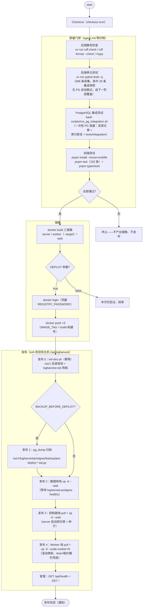
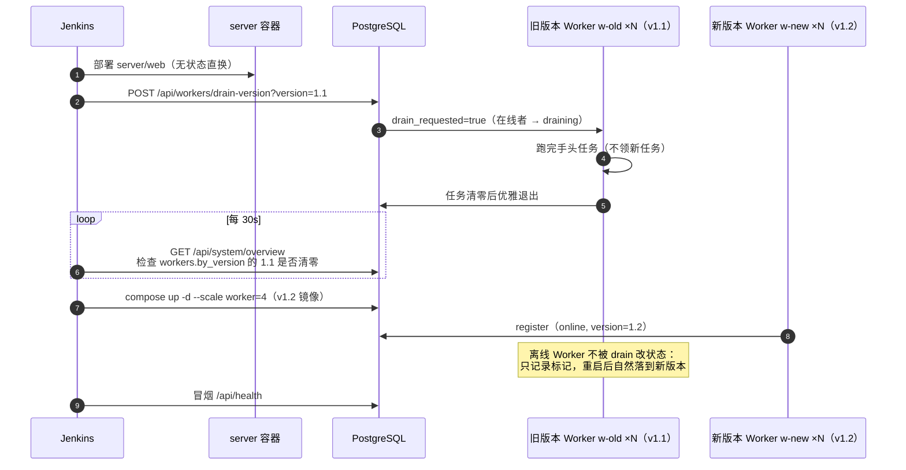

# LogHarvest Jenkins 自动化说明

> 仓库根目录的 `Jenkinsfile` 是一条声明式流水线：**质量门禁 → 镜像构建推送 → 升级前备份归档 → 三栈发布（数据库 / 控制面 / Worker）→ 冒烟验证**。它把 `agent.md` 的测试门禁固化成了流水线阶段——任何一步红，镜像不产出、发布不发生。
>
> 部署形态为三个独立 compose 栈（`deploy/{postgres,server,worker}`，外部网络 `logharvest-net` 互通），所有数据归档在数据盘 `/usr1/logharvest/`——Jenkins 对三个栈分别自动化：数据库栈确保运行且 healthy、控制面栈直接换新、Worker 栈滚动换新 + 扩容。

## 1. 流水线全景



三个栈的发布语义各不相同，这正是"独立部署"的价值：

| 栈 | 发布语义 | Jenkins 阶段 |
|---|---|---|
| 数据库（logharvest-db） | **确保运行且 healthy，不做破坏性操作**——schema 变更由 server 启动时的迁移承担；数据/备份在 /usr1 | 发布 2（`up -d --wait`） |
| 控制面（logharvest-app） | **无状态直换**：pull 新镜像 → `up -d --wait`（server/web 均有健康检查） | 发布 3 |
| Worker（logharvest-worker） | **滚动换新 + 扩容**：pull → `up -d --no-deps --scale worker=N worker`；交接安全由 drain 语义与租约栅栏兜底（§3） | 发布 4 |

## 2. 前置准备

| 项 | 说明 |
|---|---|
| Jenkins 插件 | Pipeline、Docker、AnsiColor、Credentials Binding、SSH Pipeline Steps |
| 节点工具 | Docker + Compose v2.23+（`--wait`）、uv、Node 20+/pnpm（或把构建阶段改为容器 agent） |
| 凭据 | `LOGHARVEST_REGISTRY_CRED`（Secret text：镜像仓库地址）、`REGISTRY_USER`/`REGISTRY_PASSWORD`（镜像登录）、`DEPLOY_HOST`（Secret text：发布主机）、`DEPLOY_SSH_KEY`（SSH 私钥，用户 `deploy`） |
| 目标主机 | Docker + Compose v2；仓库检出在 `/opt/logharvest`（deploy 用户可 `git pull`）；`sudo bash deploy/init-dirs.sh` 已执行（或交给流水线"发布 0"）；三个栈的 `deploy/<栈>/.env` 已按 `*.env.example` 配置（数据目录默认 /usr1，改路径需同步 init-dirs.sh） |
| 新建任务 | Pipeline script from SCM → `Jenkinsfile`；参数化构建（`IMAGE_TAG` / `WORKER_SCALE` / `BACKUP_BEFORE_DEPLOY` / `DEPLOY`） |

## 3. Worker 滚动升级语义（drain + 租约栅栏）

Worker 是唯一有状态的进程角色（手头可能正跑着小时级任务），换新必须"跑完再退"。流水线默认采用**强替换 + 兜底回收**；若采用严格 drain 滚动（双版本并存），插入以下步骤：



两条纪律（无论哪种滚动方式都成立）：

1. **旧版本必须清零再撤**：`GET /api/system/overview` 的 `workers.by_version` 含 offline 行，是确认旧版本清零的权威口径（前端 Worker 管理页同款展示）。
2. **强杀不丢任务**：流水线默认的 `--scale` 直换若强杀在跑任务的 Worker，`recover_stale` 会在 120 秒内回收任务交给新副本重试；租约栅栏（`id + attempts + status`）保证旧进程的迟到写入全部失效。

## 4. 升级前备份归档

`BACKUP_BEFORE_DEPLOY=true`（默认）时，流水线在变更任何服务之前执行：

```bash
docker exec logharvest-postgres pg_dump -U logharvest -d logharvest \
  | gzip > /usr1/logharvest/postgres/backup/pre-deploy-<时间戳>.sql.gz
```

归档与 `--profile backup` 的每日定时备份（保留 `BACKUP_KEEP_DAYS=14` 天）同目录，构成 `/usr1` 数据盘上的完整恢复点序列。失败即中止发布——备份不成功不动生产。

## 5. 流水线参数

| 参数 | 默认 | 说明 |
|---|---|---|
| `IMAGE_TAG` | `build-<BUILD_NUMBER>` | 三镜像统一标签；发布后建议在三个栈 `.env` 固化为该值 |
| `WORKER_SCALE` | `4` | Worker 副本数（设计口径 4–6，内存压力时降） |
| `BACKUP_BEFORE_DEPLOY` | `true` | 发布前 pg_dump 归档到 /usr1 |
| `DEPLOY` | `false` | 默认只做"门禁 + 构建镜像"的验证构建；置 true 才推送与发布 |

## 6. 回滚

```bash
# 三栈独立回滚：镜像仓库里回退标签，逐栈重放发布命令
IMAGE_TAG=build-<上一个绿构建号> \
  docker compose -f deploy/server/docker-compose.yml --env-file deploy/server/.env up -d --wait server web
IMAGE_TAG=build-<上一个绿构建号> \
  docker compose -f deploy/worker/docker-compose.yml --env-file deploy/worker/.env \
  up -d --no-deps --scale worker=4 worker
```

数据库回滚：升级期间的迁移向后兼容（"先加后删"纪律），一般只回镜像；需要回到历史数据点时，先 `alembic downgrade`，再从 `/usr1/logharvest/postgres/backup` 恢复归档（恢复命令见 [deployment-docker.md](deployment-docker.md) §6）。

## 7. 与测试门禁的关系

- `agent.md` 是对 AI 协作与人工提交的本地门禁，`Jenkinsfile` 是同一套门禁的 CI 强制版：`ruff`/`mypy`/`pytest`/PG 集成/`vitest`/`vue-tsc` 全绿是产出镜像的前置条件。
- 真实 PostgreSQL 集成门禁（`PostgreSQL 集成测试` 阶段）跑 `scripts/run_pg_integration.sh`：脚本自建**一次性 PG 容器**（随机端口、退出即删，不接触部署库），执行空库 `alembic upgrade head` + `file_tasks` 部分索引断言 + `tests/integration/`（19 条，`LOGHARVEST_TEST_PG_URL` 指向该一次性容器）。单元阶段跳过的 20 条用例中，19 条 PG 集成用例由此覆盖（另 1 条是依赖 POSIX FIFO 的平台相关用例，与 PG 无关）。
